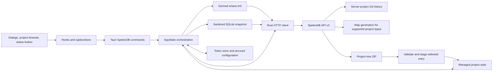
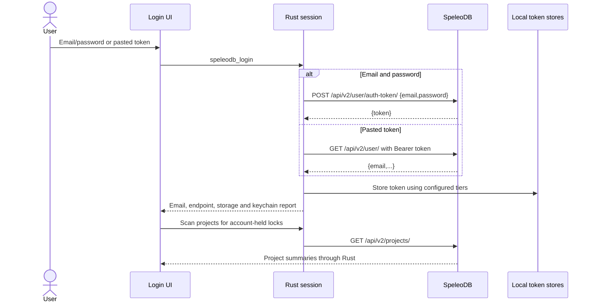
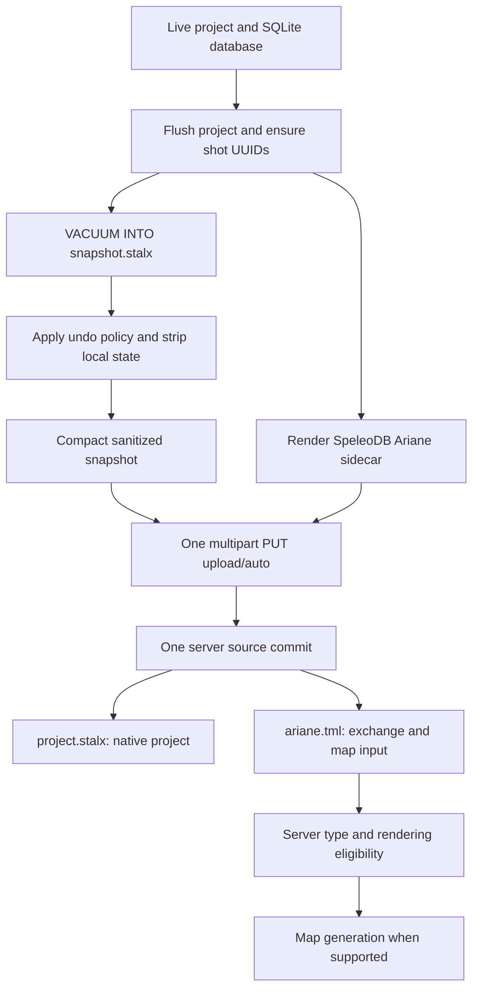
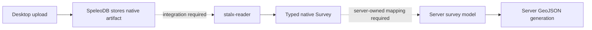
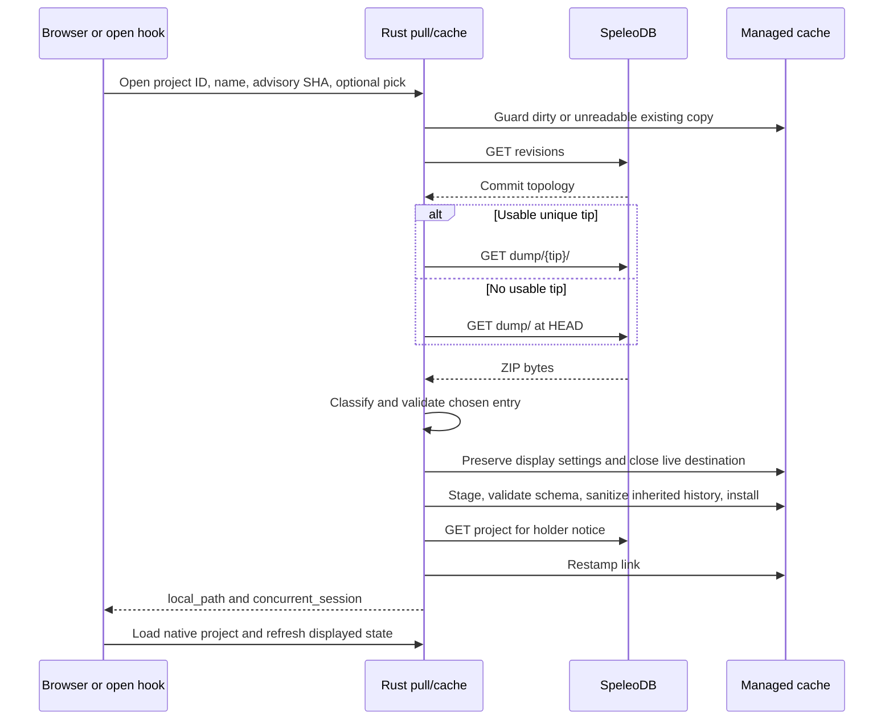

# SpeleoDB integration and exchange contract

This is the implementation reference for Stalagmight's contract with SpeleoDB:
the requests it makes, the data it publishes and consumes, and the local rules
that make a remote project editable, recoverable, and safe to hand to another
editor. It covers the desktop application, including operations initiated by
background status checks and exit handling.

Analysis baseline: Stalagmight `fa38e6e73`, reviewed 2026-11-07. Server-side
authorization and response behavior were also checked against the public
[SpeleoDB source at bafa787d18b8d025833ac8a7f7c2cb71cf3141f0][server]. That
checkout is a source reference, not proof of what a particular deployment runs.
This analysis did not authenticate to a server or mutate remote projects. The
public schema endpoint could not be read through the documentation browser.
Deployment-specific integration testing remains described in
[speleodb-dev-testing.md](speleodb-dev-testing.md).

## Contents

- [Analysis scope and method](#analysis-scope-and-method)
- [Architecture and ownership](#architecture-and-ownership)
- [Identity, authentication, and transport](#identity-authentication-and-transport)
- [HTTP endpoint inventory](#http-endpoint-inventory)
- [Wire data structures](#wire-data-structures)
- [Project files and data published](#project-files-and-data-published)
- [Native reader contract and server integration gap](#native-reader-contract-and-server-integration-gap)
- [Local persistence and edit state](#local-persistence-and-edit-state)
- [Open, download, and adopt](#open-download-and-adopt)
- [Acquire, edit, reconcile, and push](#acquire-edit-reconcile-and-push)
- [Revision history, restore, revert, and undo](#revision-history-restore-revert-and-undo)
- [Metadata, permissions, and project administration](#metadata-permissions-and-project-administration)
- [Close, logout, switching, and recovery](#close-logout-switching-and-recovery)
- [Errors and frontend routing](#errors-and-frontend-routing)
- [Background traffic and observability](#background-traffic-and-observability)
- [Compatibility boundaries and limitations](#compatibility-boundaries-and-limitations)
- [Verification and maintenance](#verification-and-maintenance)
- [Source call-site inventory](#source-call-site-inventory)

## Analysis scope and method

The analysis follows the exchange in both directions, using this sequence:

1. Enumerate every production HTTP function, including requests hidden behind
   helpers, retries, error probes, and cleanup.
2. Trace each HTTP function into Rust orchestration, Tauri commands, and the
   frontend action that triggers it.
3. Read the consumed response models and emitted JSON/multipart bodies. Separate
   fields actually used from fields the server returns but the client ignores.
4. Trace the `.stalx` and `.tml` artifacts through save, snapshot, sanitization,
   upload, ZIP classification, staged replacement, and reload.
5. Follow permissions, lock acquisition/release, BASE revision checks, dirty
   timestamps, session identity, and undo policy through successful and failed
   operations.
6. Cross-check server authorization and response construction against source,
   then use regression tests to identify the intended edge-case behavior.

The scope is every SpeleoDB HTTP operation implemented by this application, not
every API offered by SpeleoDB. Stalagmight does not exchange individual survey
shot edits over REST, synchronize a local Git checkout, or merge concurrent
survey changes. It exchanges complete project artifacts and uses server Git
history for revision identity and recovery.

Older documents in `docs/plans/` describe intent and past defects. They are not
the current lock protocol. In particular, the session-race report predates the
generation and reclaim checks now implemented in [session guards][session].

## Architecture and ownership



| Boundary | Owner and responsibility |
|---|---|
| User intent and prompts | [speleoStore][store], [useSpeleoActions][actions], [useOpenRemoteProject][open-hook], dialogs, and GlobalView. Confirm destructive replacements, route typed outcomes, and refresh the displayed tree. |
| IPC | [commands/speleodb.rs][ipc]. All SpeleoDB commands run blocking HTTP/keychain work through `spawn_blocking`; errors remain structured. Registration is in [src-tauri/src/lib.rs][app]. |
| Workflow | [core/state/speleodb.rs][core] and sibling modules. Decide whether to acquire, upload, replace, stamp metadata, clear dirty state, or release. |
| Wire transport | [client.rs][client]. URL/header construction, JSON and multipart encoding, timeouts, retry policy, response parsing. |
| Pure synchronization decisions | [sync.rs][sync]. Revision topology, ancestry, BASE fence, polling verdicts, and history traversal. |
| Persistence | [SpeleoLink][link-model], [SQLite settings][db-settings], [snapshot sanitization][sanitize], [cache replacement][cache]. |
| Server authority | Account validity, effective permissions, account-owned project mutex, project metadata, accepted commits, and available artifact trees. |

The webview receives email, endpoint, storage status, project data, and typed
results. Login never returns the server token to the webview. The frontend can
supply a pasted token or password to login; subsequent HTTP authorization is
owned by Rust.

## Identity, authentication, and transport

### Endpoint and account identity

Requests use:

```text
<endpoint with trailing slashes removed>/api/v2/<relative path>
Authorization: Bearer <token>
```

The credential-exchange request is the exception: it sends email/password JSON
without a Bearer header. JSON requests set `Content-Type: application/json`.
Multipart boundaries are generated by the HTTP library.

Backend endpoint precedence is the first nonblank value among the explicit
login override, `DEV_SPELEODB_URL`, and `config.speleodb.endpoint`. This is a
base server URL, not an `/api/v2` URL. All URL paths in this document are
relative to that base unless they explicitly include `/api/v2/`.

[auth.rs][auth] normalizes an endpoint to scheme, lowercase host, and nondefault
port for credential identity; it drops path/trailing slash and default ports.
The keyring service is `stalagmight`; the account key is
`<normalized endpoint>|<email>`. `account_key` appends the supplied email as-is.
Lock-holder comparisons are case-insensitive, so do not assume all identity
comparisons have identical email normalization. The frontend mirrors deployment
comparison in [speleoEndpoint.ts][endpoint-util].

Project IDs are validated as UUIDs before the application constructs project
paths. Revision arguments used in download URLs must contain 7 to 40 ASCII hex
digits. Server-derived topology tips are checked too. Autocomplete text is
percent-encoded. See [revision validation][revisions] and [pull dating][pull].

### Login, persistence, and logout



- A nonblank pasted token takes precedence; typed email is ignored and `/user/`
  supplies the account email. Email/password login uses the submitted trimmed
  email after the token exchange; it does not issue a second `/user/` request.
- The token endpoint is assumed to be non-rotating/get-or-create, which is why
  this POST is retryable. Invalid login credentials normally produce HTTP 400
  with validation errors, not necessarily 401.
- Keychain is the preferred persistent store. Explicit fallback choices are
  `session_only` and `plaintext`; configuration also tracks keychain refusal,
  disabling, and whether a token is believed to exist for an account.
- Plaintext storage lives under `<config>/speleodb/tokens/`, with sanitized
  account-key filenames. Unix files are created/tightened to mode `0600`;
  Windows relies on the user profile ACL. Memory fallback does not persist.
- The initial keychain failure can return `needs_storage_choice=true`; moving
  the already-held token requires no second login. Storage moves report their
  actual result, including failures to remove older persistent copies.
- Session rehydration is attempted lazily once from the configured account and
  persistent stores. `speleodb_session` reports local session state; it does not
  prove the token is currently accepted by the server.
- Logout is local credential removal plus edit-session teardown and possible
  lock release. There is no server token-revocation/logout HTTP request. A
  credential-cleanup error can be returned after the live session has already
  been dropped. See [credentials][credentials] and [logout][logout].

### Transport policy

| Property | Current implementation |
|---|---|
| HTTP library | Synchronous `ureq`, fresh agent per attempt. Non-2xx responses remain available for explicit status handling. |
| Redirects | Disabled (`max_redirects(0)`); a redirect is not an automatic follow-up request. |
| Standard timeout | 30 seconds per attempt, including response-body reading. |
| Dump and upload timeout | 120 seconds per attempt. |
| Lazy lock probe | One GET with a 5-second budget and no retry. |
| Retry-safe calls | GETs, token exchange, delete-project, and release-all. Up to three attempts total, after 200 ms and 500 ms delays, for transport failures or 5xx. |
| Single-attempt writes | Create, metadata PATCH, upload, acquire, release, and permission mutations. No automatic replay after an uncertain response. |
| Response ceilings | Dump ZIP: 640 MiB. Ordinary JSON/body reads: library default 10 MiB. Multipart upload has no analogous application-level size ceiling here. |
| Body-limit failure | Dump/read retry loop reports a size/parse failure and does not retry it as a connectivity failure. |
| TLS policy | HTTPS accepted. HTTP permitted for localhost, or hosts resolving exclusively to loopback/private/link-local addresses; `insecure_http=true` permits public HTTP explicitly. Schemes other than HTTP/HTTPS are rejected. |

The HTTP rule runs before dialing, including on permission writes that bypass
the retry helper. One warning per process records unencrypted HTTP use. DNS
policy checking and the HTTP connection are separate operations; the implementation
does not pin the checked DNS address into the connection. See [tls.rs][tls].

There is no application `If-Match`, expected-BASE field, idempotency key, client
session ID, lease token, or revision compare-and-swap in a push. The client-side
fence and server mutex carry that responsibility.

## HTTP endpoint inventory

All paths below have the prefix `/api/v2/`. All non-login calls use Bearer
authorization. `R` means the retry-safe policy above; `W` means one attempt.
The client accepts any 2xx unless a special result is stated. Response bodies
must still satisfy the consumed model: an empty 204 is not sufficient for a
function that parses a `Project`.

Server permission levels below come from the reviewed server source. They are
enforced on the server; frontend controls are additional presentation gates.

### Session and project reads

| Method and path | Sent | Received/consumed | Policy | Where and why |
|---|---|---|---|---|
| `POST user/auth-token/` | `{email,password}` | Object with required `token: string` | R | `client::login`; `speleodb_login` email/password branch. |
| `GET user/` | No body | Required `email: string`; other profile fields ignored | R | `fetch_user_email`; pasted-token login and ambiguous-403 identity probe. |
| `GET projects/` | No body/query | Bare array of `Project` | R | `list_projects`; remote browser, GlobalView, held-lock scan. No pagination traversal is implemented. |
| `GET projects/{id}/` | No body | Bare `Project` | R | `get_project`; status, holder checks, metadata form, pre-push name fold, adoption finalization. Requires read access. |
| `GET projects/{id}/` | No body | Same `Project` | One 5s attempt | `get_project_probe`; lazy pre-edit lock verification. Same URL, different latency contract. |
| `GET projects/{id}/revisions/` | No body | `{commits:[...],...}`; embedded `project` ignored | R | `get_revisions`; every authoritative HEAD/fence check, history display, dating downloads, unwind/rewind targets. Requires read access, no lock. |
| `GET projects/{id}/download/dump/` | No body | Raw ZIP bytes | R, 120s | `download_dump`; undated HEAD fallback and advisory candidate probe. Requires read access. |
| `GET projects/{id}/download/dump/{hexsha}/` | No body | Raw ZIP tree at revision | R, 120s | `download_dump_at_hash`; dated open/adopt/fast-forward, View/Restore, candidate probe and forward-undo policy inspection. |

### Project writes and mutex operations

| Method and path | Sent | Received/consumed | Policy | Server gate and application caller |
|---|---|---|---|---|
| `POST projects/` | Creation JSON described below | `Project`, normally 201 | W | Authenticated account; `create_project_with` from `speleodb_publish`. |
| `PATCH projects/{id}/` | Changed metadata, `exclude_geojson`, or `type` | `Project` | W | Write access, no project mutex requirement; metadata settings, rendering toggle, adoption/type repair. |
| `DELETE projects/{id}/` | No body | Any 2xx; body ignored | R | Admin; `delete_project` from project administration. Server soft-deactivates the project. A 404 is still surfaced by the client, even after a retried successful delete. |
| `POST projects/{id}/acquire/` | Empty body | Updated `Project` | W | Write access; Start Editing/reconnect, adoption, initial publish. Another account's mutex yields 400. |
| `POST projects/{id}/release/` | Empty body; client does not send optional server `comment` | Updated `Project` | W | Write access plus owner/admin release rules; Done, explicit release, recovery and lifecycle cleanup. |
| `DELETE user/release_all_locks/` | No body | Any 2xx; body ignored | R | Authenticated user; release every mutex held by that account, including projects not open here. |
| `PUT projects/{id}/upload/auto/` | Multipart: two `artifact` parts plus `message` | Upload envelope with nested `project` and top-level `hexsha`; 304 is a successful no-change result | W, 120s | Write access **and** `UserOwnsProjectMutex`; Push, Done, publish and adopt. |

### Collaborators, teams, and lookup

| Method and path | Sent | Received/consumed | Policy | Where and server gate |
|---|---|---|---|---|
| `GET projects/{id}/permissions/user/` | No body | `{permissions:[{user,level}],...}` | R | `list_user_permissions`; collaborator roster, read access. |
| `POST projects/{id}/permission/user/detail/` | `{user:email,level}` | Any 2xx; body ignored | W | `add_user_permission`; add collaborator, admin. |
| `PUT projects/{id}/permission/user/detail/` | `{user:email,level}` | Any 2xx; body ignored | W | `set_user_permission`; change collaborator level, admin. |
| `DELETE projects/{id}/permission/user/detail/` | **JSON body** `{user:email}` | Any 2xx; body ignored | W | `remove_user_permission`; revoke collaborator, admin. |
| `GET projects/{id}/permissions/team/` | No body | `{permissions:[{team,level}],...}` | R | `list_team_permissions`; collaborator roster, read access. |
| `POST projects/{id}/permission/team/detail/` | `{team:uuid,level}` | Any 2xx; body ignored | W | `add_team_permission`; admin; team grants cannot be ADMIN. |
| `PUT projects/{id}/permission/team/detail/` | `{team:uuid,level}` | Any 2xx; body ignored | W | `set_team_permission`; admin; same level restriction. |
| `DELETE projects/{id}/permission/team/detail/` | **JSON body** `{team:uuid}` | Any 2xx; body ignored | W | `remove_team_permission`; admin. |
| `GET teams/` | No body | Bare array `[{id,name,...}]` | R | `list_teams`; add-team picker and roster UUID-to-name resolution. |
| `GET user/autocomplete/?query=<encoded>` | Trimmed substring in query | Bare array `[{email,label,...}]` | R | `list_user_autocomplete`; add-user typeahead. Backend returns `[]` without HTTP below 3 characters; reviewed server returns at most 10 matches. |

Plural `permissions` lists and singular `permission/.../detail` mutations are
different routes. Permission DELETEs intentionally have request bodies. The
shared `send_json_request` constructs explicit HTTP requests to preserve them.

`create_project` is a convenience used by tests to seed legacy `type: other`
projects; production uses `create_project_with`. `grant_permission` is a
test-support helper over the same user-permission POST. They add no endpoints.

## Wire data structures

The consumed schemas live in [models.rs][wire-models], with authentication and
upload envelopes in [client.rs][client]. Unknown object fields are ignored by
Serde. Unknown permission/visibility enum strings are not accepted as new
capabilities: deserialization fails.

### Project and permission vocabulary

| Field | Consumed type/default | Meaning |
|---|---|---|
| `id` | Required string | Project identity, expected UUID. |
| `name` | Required string | Server-authoritative display name. |
| `permission` | Optional enum, default absent | `WEB_VIEWER`, `READ_ONLY`, `READ_AND_WRITE`, `ADMIN`. The server can omit the field when no permission applies. |
| `active_mutex` | Optional object | Only `user: string` is consumed, interpreted as holder email. Other mutex metadata is ignored. |
| `latest_commit` | Optional `{id:string}` | Advisory project pointer; not the authoritative synchronization HEAD. |
| `type` | String, default empty | Mapped to Rust `kind`. New managed projects use `stalagmight`; `other` is legacy. |
| `exclude_geojson` | Boolean, default false | Whether server map generation is excluded. |
| `description`, `country` | Optional strings | Metadata editor projects missing values to empty strings. |
| `visibility` | Optional `PRIVATE` or `PUBLIC` | Metadata editor defaults absence to PRIVATE. |
| `latitude`, `longitude` | Optional floating-point numbers | Project metadata coordinates, distinct from survey datum coordinates in the artifacts. |

The stored/server-input type vocabulary includes `ariane`, `compass`, `stalagmight`,
`stickmaps`, `therion`, `walls`, and `other`. The client does not deserialize
`type` as a closed enum. Dump contents determine whether a project can be
opened; a type label alone is not evidence that a valid `.stalx` is present.
The inspected server serializes software labels in uppercase (for example,
`STALAGMIGHT`) and accepts case-insensitive writes; the client's managed-type
comparisons are case-insensitive.

Permission ordering in Rust is WEB_VIEWER < READ_ONLY < READ_AND_WRITE < ADMIN.
Read access is required for project detail, revisions, and downloads in the
reviewed server. Some application comments call history/metadata reads
"permission-free"; read this as "no edit lock needed", not anonymous or
unrestricted access.

### Frontend projections

The frontend does not receive the full server objects. The Rust projections in
[models.rs][wire-models] define the other exchange shapes:

| Projection | Fields or variants |
|---|---|
| `SpeleoProjectSummary` | `id`, `name`, `permission`, `lock_holder`, `type_tag`, `latest_commit_sha`. |
| `SpeleoLoginResult` | `user_email`, `endpoint`, `keychain_backed`, `storage`, `keychain`, `needs_storage_choice`. |
| `SpeleoSessionStatus` | `logged_in`, nullable `user_email` / `endpoint` / `storage`, `keychain_backed`, `keychain`. |
| Storage vocabulary | `keychain`, `plaintext`, `memory`; keychain report: `not_attempted`, `available`, `unavailable`, `declined`, `disabled`. |
| `SpeleoLinkStatus` | `is_remote`, `edit_enabled`, `has_unpushed_edits`, `unwound`, `permission`, `lock_holder`, `remote_state`, `access_denied`, optional `server_error`, `exclude_geojson`, `undo_mode`, `force_editing`, `allow_force_edit`, optional `project_id`. |
| `SpeleoLocalProjectState` | `has_local_copy`, `has_unpushed_edits`, `last_edit_at`, `is_open`, `state_unknown`; returned in a map keyed by project ID. |
| `SpeleoProjectMetadata` | `name`, `description`, `country`, `visibility`, `latitude`, `longitude`, `exclude_geojson`. |
| `SpeleoCollaborators` | `users: [{email,permission,is_self}]`, `teams: [{team_id,team_name,permission}]`. |
| Team/user suggestions | `SpeleoTeamOption {id,name}`; `SpeleoUserSuggestion {email,label}`. |
| Dump candidates | `{entry_path,size_bytes,modified}`; `modified` is an optional ZIP timestamp without a timezone suffix, not a server revision timestamp. Candidate kind is `stalx` or `ariane`. |
| Open/publish | Open: `{local_path,concurrent_session}`. Publish: `{project_id,endpoint,local_path}`. |
| History targets | Unwind: `{hexsha,is_current,discards_unpushed}`; rewind: `{hexsha,is_latest}`; either can be null when no target is available. |

The workflow sections specify tagged `kind` results and adoption receipts. IPC
fields retain Rust snake_case in responses; Tauri input argument names use the
frontend's camelCase spelling.

### Revision topology fields

`RevisionHistory` consumes `commits`, defaulting to an empty array if omitted.
Each commit consumes:

| Field | Contract |
|---|---|
| `id` | Required string, Git object ID. |
| `parent_ids` | String array, default empty. Required in practice for meaningful topology. |
| `author_email` | String, default empty. Used for conservative ambiguous-push ancestry recovery. |
| `authored_date` | Optional display string. Not used to order the synchronization graph or compare local edit epochs. |
| `message` | Optional display string; also used with root topology to hide the automated creation commit in history UI. |

`sync::tip_of` finds the unique commit that is not a parent of another returned
commit. It does not trust array order or timestamp order. Multiple heads,
missing parents, cycles, merges, or a BASE absent from the required walk can
prevent a safe reconciliation. The application assumes a complete usable
linear ancestry, with no client pagination fetch.

### Upload success and no-change

Illustrative response shape, with synthetic values:

```json
{
  "files": ["misc/project.stalx", "ariane.tml"],
  "message": "Updated in Stalagmight",
  "hexsha": "1111111111111111111111111111111111111111",
  "browser_url": "/some/server/revision/page/",
  "project": {
    "id": "11111111-1111-4111-8111-111111111111",
    "name": "Synthetic survey",
    "permission": "ADMIN",
    "type": "STALAGMIGHT",
    "active_mutex": {"user": "editor@example.invalid"}
  }
}
```

Only `project` and optional top-level `hexsha` are parsed. `files`, `message`,
`browser_url`, and additional fields such as the reviewed server's
`geojson_status` are ignored. The client replaces the parsed project's
`latest_commit` with the nonempty top-level `hexsha`. If that field is missing
or empty, it deliberately does **not** fall back to nested
`project.latest_commit`: the previous local BASE is retained.

HTTP 304 is handled by orchestration as a confirmed no-change push. It carries
no new SHA, so BASE remains unchanged. Dirty clearing is still conditional on
the captured edit epoch. A confirmed artifact upload does not prove that server
map generation finished or succeeded.

## Project files and data published

### The two-artifact commit



| Multipart field | Wire filename | Content-Type | Source |
|---|---|---|---|
| `artifact` | `project.stalx` | `application/vnd.sqlite3` | Sanitized, self-contained SQLite snapshot. Local staging basename is `snapshot.stalx`. |
| `artifact` | `ariane.tml` | `application/octet-stream` | Derived Ariane ZIP containing survey XML, rendered from the same application project. |
| `message` | Not a file | Text field | Nonblank commit message. Ordinary Push/Done trims input and defaults to `Updated in Stalagmight`. |

The repeated field name is exactly `artifact`, never `artifact[]`. The `.tml`
MIME is significant because the server's Ariane processor validates it.
Artifact wire names are independent of local filenames. Uploads are additive
to the server tree; publishing `snapshot.stalx` under that name would create a
second native file and make future dumps ambiguous. Old stray files are not
deleted by this upload.

The inspected server validates a nonempty message and at least one artifact,
normalizes message whitespace/newlines, and allows at most 20 files. Its
per-file size setting defaults to 150 MiB. There is a concrete discrepancy in
the total-size check: [FileUploadView][server-file] compares summed artifact
bytes with `DJANGO_UPLOAD_TOTAL_FILES_LIMIT * 1024 * 1204`, using the file-count
setting and `1204`. With the inspected default of 20, that is **24,657,920
bytes**, despite a separately declared 150 MiB total-size setting. Oversize
uploads return 400. Stalagmight performs no matching preflight size check and
must accept the deployment's actual limit. These are pinned source observations,
not a promise that all deployed servers have these settings or this expression.

The complete native database is exchanged, not only visible survey rows. It
includes survey topology, station/shot attributes and identities, comments,
datums, project settings, and other durable project tables such as planning
data. See [saving.md](saving.md) and [SQLite schema][schema].

### Snapshot sanitization and undo-history policy

[sanitize_push_snapshot][sanitize] operates on the copy, never the live database:

| Data | Publication contract |
|---|---|
| Survey data and durable project settings | Retained. |
| `imported_file_hashes`, `imported_section_hashes` | Retained so collaborators inherit import deduplication. |
| `resolved_warnings` | Retained as shared project decisions. |
| `speleo_link` | Retained, including endpoint, ID, name, BASE, verification field, and project undo policy; dirty flag cleared and `last_edit_at` set to NULL. Pull restamps session-specific link values. |
| `undo_stack` in `full` mode | History since the preceding commit may be published. Inherited rows from an older loaded revision are filtered using the watermark. |
| `undo_stack` in `disabled` mode | Stripped; undo still works locally under the ordinary bounded policy. |
| `redo_stack` | Always stripped. |
| `speleo_undo_chain`, `speleo_undo_watermark` | Always stripped: local history-navigation state. |
| `display_settings` | Best-effort removal of machine-local view preferences. |
| Legacy `collab_state` | Best-effort removal of obsolete local wiring. |

History-table cleanup is transactional and fatal on failure. Dirty-bit clearing
and final compaction are fatal too; the upload must not proceed with those
unsanitized. Preference/legacy-table removal logs failures and can continue.
Missing tables are tolerated for older file shapes.

The final `VACUUM INTO` writes a sibling compacted copy and renames it over the
snapshot. SQL DELETE alone would leave removed history bytes on free pages in
the uploaded database. This also requires enough free disk space in the staging
directory for another database copy. See [undo_mode.rs][undo-mode] and
[undo-redo.md](undo-redo.md).

`full` is the default for new/legacy-initialized linked projects. Once explicit,
the policy belongs to the project and travels to collaborators. Changing it is
an edit and marks the project unpushed. An unknown persisted database policy
fails closed to `disabled`; the configuration enum's unknown sentinel resolves
to its default. These are deliberately different parsing contexts.

### Ariane sidecar and server map contract

[export_tml_for_speleodb][tml] uses a separate profile from user-facing Ariane
export. The `.stalx` remains the native representation; the sidecar is a derived
exchange/preview representation with the limitations in
[ariane-export.md](ariane-export.md).

The profile enforces downstream conversion expectations, including:

- Stable shot UUIDs are ensured before snapshotting. Sidecar UUIDs are emitted
  only when valid, canonical RFC 4122 v4 and unique in the document. Unsupported
  or repeated optional UUIDs are omitted rather than rejecting the native data.
- Geometry is repaired for the consumer's serialized length/depth constraints;
  the checks account for the six decimal places actually written. Azimuths are
  normalized, including non-REAL shots the server otherwise uses raw.
- GPS anchors are placed on entrance START shots using their applicable datums.
  No datum means no invented anchor. A component that rounds to zero is nudged
  by one micro-degree for the server's unset-coordinate convention; coordinates
  are clamped to geographic limits in this derived output.
- Dates are made parseable and constrained to the converter's 1900-2035 model
  range. The converter's section-field separator is removed from section and
  explorer text.
- A one-shot document gets a parentless VIRTUAL padding shot to avoid the
  consumer's singleton XML shape problem. IDs are checked for uniqueness.
- More than 25,000 sidecar shots generates a map-conversion warning, not a
  truncation or refusal of the native survey upload.

`exclude_geojson=false` permits otherwise-supported server rendering; creation sends it as false.
Enabling rendering on an existing project PATCHes the flag and is intended to
take effect on a subsequent push. Stalagmight does not call the server's
GeoJSON-status endpoint or wait for a conversion job. The reviewed server
schedules conversion after accepting eligible source artifacts and can report
a separate conversion status in the upload response, which this client ignores.

**Current server integration gap:** the inspected server supports conversion
only for `ARIANE` and `COMPASS`, not `STALAGMIGHT`. Its upload scheduling returns
`geojson_status: "not_requested"` for an unsupported type (or `"skipped"` when
excluded). Therefore the co-pushed `.tml` does not by itself enable map generation
for a newly labelled Stalagmight project. Existing map artifacts can remain
readable after a type change. This is explicit in the pinned
[server format reference][server-formats] and [upload eligibility code][server-file].
The sidecar hardening above describes what the client still emits and why; it
is not evidence that this server consumes it for a Stalagmight map.

## Native reader contract and server integration gap

Stalagmight also supplies the [stalx-reader crate][reader] for a server to read
the native artifact. It is separate from the desktop REST client and performs
no SpeleoDB HTTP calls. The inspected server checkout has the `stalagmight`
software choice, but no native Stalagmight processor or reader-to-map wiring.
An inline client comment saying that the server maps `.stalx` through this
reader describes the intended integration, not the inspected server behavior.



The local crate is version `0.1.0`, with exact `=0.1.0` model/persistence
dependencies in its manifest. This is the checked-in API version; publication
or installation in a deployment was not verified. The reader contract is:

| Surface | Expected behavior |
|---|---|
| `read_file(path)` | Read a `.stalx` using default options; return `Survey` or typed `ReadError`. |
| `read_file_with(path, options)` | File input with explicit bounds and station-computation choice. |
| `read_bytes(bytes, options)` | Equivalent bounded read from supplied bytes. |
| Source preservation | Copy to private temporary storage; run integrity/schema checks and the app's forward migrations on the copy. Never write the uploaded source. |
| Schema compatibility | `SUPPORTED_SCHEMA_VERSION` equals persistence schema 18 at this baseline. Newer schemas return `NewerSchema`; consumers need a compatible reader upgrade. The returned `schema_version` records the input version before migration. |
| Default byte/time bounds | 64 MiB input/value bound and a 30-second read deadline. These are independent of the desktop's 640 MiB ZIP/512 MiB extraction ceilings and server upload limits. |
| Default row-count bounds | 100,000 sections, 2,000,000 shots, 200,000 station merges, 50,000 loop closures. |
| SQLite precautions | Reject executable/unexpected schema forms, use defensive connections with `trusted_schema` off, no mmap, value limits, cell-size checking, and interruption deadlines. |
| History | Does not load undo/redo as survey data. Migrations may remove obsolete history from the private copy. |
| Optional station output | `with_stations=false` by default. When enabled, use the app's measured, unadjusted geometry with manual offsets. |

The [public survey model][reader-survey] carries metadata, sections and shots,
station merges, datums, closures, comments, frame datum, optional station
positions, and a count of dropped unresolved references. Sections include
direction, north reference, quality/color, and azimuth correction with its
source. Shots include UUID/derived-UUID flag, kind, length, input/output
azimuth/depth/pitch, LRUD, temperature, marker index, and comment.

Units and identities are part of the consumer contract: metres, degrees,
positive-down depth/pitch; stored azimuth plus section correction gives the
true-north bearing. A shot is keyed by `(section_id, uuid)` because UUIDs are
unique within a section, while station indices can shift after edits. Missing
or unusable/repeated UUIDs receive deterministic derived identities. Collections
are deterministically ordered; `modified_at` changes on save and should not
be treated as stable content identity.

Optional station coordinates use east/north/depth axes. `anchor=None` denotes
a floating component and has no meaningful geographic position; geographic
coordinates are supplied only for anchored stations. Server-owned mapping must
respect these distinctions and choose how its survey/GeoJSON types represent
them. It must not infer georeference for every component from one project
latitude/longitude.

SQLite work is interrupted within statements; later Rust steps check deadlines
between steps, not during every operation. Input/count limits are not a hard
heap cap, and allocation/stack failure can abort. The crate recommends an
isolated worker that the consumer can terminate. The design rationale and
remaining server work are recorded in
[the reader design](plans/2026-10-29_stalx-reader-crate.md); its dated "current
state" table is historical, while the source and caveats above are the baseline
for this document. No interchange-JSON upload or client-produced GeoJSON upload
has replaced the two-artifact HTTP exchange.

## Local persistence and edit state

### Managed cache and local link

The managed file is:

```text
<application cache>/speleodb/<project UUID>/project.stalx
```

This directory is also used for `snapshot.stalx`, `ariane.tml`, and temporary
download/adoption staging. The cache is keyed by project UUID, not endpoint or
account. Treat it as a working copy with potentially irreplaceable unpushed
work, not disposable HTTP cache data.

The single `speleo_link` row makes a file remote. `is_remote` is derived from
its existence, not a separate authoritative toggle.

| Persisted link field | Meaning and update rules |
|---|---|
| `endpoint`, `project_id`, `project_name` | Origin identity and captured display name. Name can be folded from server metadata. |
| `base_commit_sha` | BASE describing the revision on which local work rests. NULL is the empty/unknown fallback representation; never substitute an empty string. |
| `has_unpushed_edits` | Persistent remote dirty flag. Successful mutations set it; local save/autosave never clears it. |
| `last_edit_at` | RFC-3339 local edit epoch used to decide whether a successful upload included all work. |
| `last_verify_at` | Timestamp for the lazy lock probe. Also advanced on a failed probe to avoid repeated blocking on every edit. |
| `undo_mode` | Shared project policy, materialized from the global default only when legacy/uninitialized. |

Separate persisted tables track history walking (`speleo_undo_chain`) and the
cutoff for inherited undo rows (`speleo_undo_watermark`). Neither is shared.

### Four separate facts

| Fact | Authority | What it does not prove |
|---|---|---|
| Frontend `isDirty` | Unsaved application changes | Whether already-saved work has reached SpeleoDB. |
| `has_unpushed_edits` | Local SQLite hand-off state | Whether a mutex is currently owned. |
| `edit_enabled` / `force_editing` | Rust session gates | The current server permission or holder without verification. |
| `active_mutex.user` | Last server response | Which application instance originally acquired that account's mutex. |

A loaded managed project starts read-only. The backend mutation guard enforces
the gate independently of disabled UI controls. Successful project mutations,
including undo/redo and project policy changes, mark linked data unpushed;
selection/view-only actions are separate. See [commands.rs][commands],
[app_state.rs][state], and [app-modes.md](app-modes.md).

`speleodb_local_project_states` uses local metadata reads to join cache presence,
unpushed state, last edit, open state, and `state_unknown` onto remote rows.
It performs no HTTP and needs no token. Unreadability must not be interpreted as
permission to overwrite: the replacement guard refuses both known dirty and
indeterminate existing copies.

### Managed copies outside the cache

A linked `.stalx` may be opened only at its canonical cache file, including
aliases that identify the same file. A copied managed file elsewhere raises a
typed managed-file refusal. The user can open the managed server project or
remove the copied file's link and open it locally.

`speleodb_remove_link_at` rechecks the expected project identity before stripping
the closed file, and refuses the open project. Open-project detachment uses
`speleodb_unlink`. Save-a-Copy produces an unmanaged local copy without moving
the managed session. See [foreign-file handling][foreign] and
[project_io.rs][project-io].

## Open, download, and adopt

### Normal open and refresh



The diagram groups the local replacement work; the cache helper closes a live
destination before extraction/install and attempts to reopen the old file on
failure. [pull.rs][pull] and [cache.rs][cache] define the exact order.

1. Validate project ID and local overwrite policy before downloading a large
   tree. An ordinary open refuses unpushed/unknown local state with
   `UnpushedLocalEdits {project_id,local_path,last_edit_at}`.
2. Resolve HEAD from revision topology and pin the dump to that SHA when usable.
   The browser's `latest_commit_sha` is advisory. If topology dating fails,
   normal open/adopt can download unpinned HEAD and retain the advisory BASE;
   that is a degraded fallback, not a proven correspondence between bytes and
   revision. A fast-forward without a usable pin stamps no BASE.
3. Classify the ZIP, resolve any permitted explicit selection, and extract one
   entry into application-controlled staging. Never extract a whole archive
   into paths supplied by the server.
4. Check the staged SQLite schema before cleanup or replacement, including
   rejecting hostile schema objects. Drop inherited undo/redo for normal open,
   update, and restore. Preserve the existing machine's display settings.
5. Replace the canonical file atomically, restamp the link, and load it through
   the normal project pipeline. A same-account holder detected by GET produces
   `concurrent_session=true` and a UI notice.

The refused-open alternatives are explicit: **keep local** opens the reported
path without downloading; **take remote and discard local** calls the separate
`speleodb_open_project_discarding_local` after loss confirmation. A pending
picker or adoption prompt does not authorize closing a newly opened project;
the frontend checks project/session context around asynchronous continuations.

### Dump selection and defensive limits

| Contents | Normal result |
|---|---|
| Exactly one file with case-insensitive `.stalx` suffix | Use it regardless of directory. |
| Multiple `.stalx` files | Typed ambiguity and picker; do not infer from ZIP order or silently choose the canonical-looking file. |
| No `.stalx`, exactly one basename `ariane.tml` (case-insensitive) | Offer Ariane adoption. Arbitrary `.tml`/`.tmlu` filenames are not this route. |
| No `.stalx`, several `ariane.tml` entries | Ariane ambiguity/picker. |
| Neither supported form | `EmptyDump`/nothing to open. |

`.stalx` wins over Ariane whenever present. Paths are ZIP wire strings using
`/`, not host-platform path parsing. Candidates are sorted by path; a
`project.stalx` basename is not proof that an entry is the current upload target.
The dump does not disclose the processor's configured target directory.

- Archive body ceiling: 640 MiB; extracted single-entry ceiling: 512 MiB.
- Archive entry count ceiling: 10,000; picker candidate ceiling: 32, refused
  rather than truncated. Entries declaring more than the extraction limit are
  omitted from candidate details. [Dump][dump] bounds both declared size and
  actual decompressed bytes. Limits bound the walk/extraction, but ZIP
  central-directory parsing happens before the entry-count check. Entry names
  select bytes from the archive; they never become filesystem destinations.
- Explicit choices are checked against the same downloaded archive being used.
  They must belong to the actual candidate set, with exact wire-path equality.
- Remembered choices and offered questions are scoped to session/account,
  project, and dated revision. They are not a permanent per-project preference.
  Undated HEAD cannot silently reuse a selection from a different tree.
- `speleodb_dump_candidates` is advisory and always downloads. It does not take
  a lock or install a cache file. Failures collapse to no advisory answer; the
  following real action remains responsible for reporting its own error.
- Start Editing/Update fast-forwards cannot stop mid-flow for a new ambiguous
  file choice; they refuse with a reopen instruction. Historical Ariane-only
  trees cannot be restored by substituting today's adoption flow.

### Ariane adoption

Adoption is a conversion plus an attempted first native commit, not a type-only
PATCH. [speleodb_adopt_ariane][pull] does the following:

1. Probe holder and attempt acquisition before dating/downloading. Track whether
   this flow acquired the lock or inherited the account's existing one.
2. Resolve and download a dated tree where possible, then validate the Ariane
   entry against current candidates. If `.stalx` appeared in the meantime,
   route back to normal open rather than overwriting it from Ariane.
3. Guard existing local work unless the user already confirmed discard. Extract
   the source into scratch space, import/convert, and build a native file in
   staging before installing it. Excluded non-closure shots are not imported;
   converter warnings and the excluded count are included in the import receipt.
4. Stamp the native copy linked and dirty. Conversion can succeed locally even
   if the server lock could not be acquired, so preserve the usable local copy
   and report the upload outcome separately.
5. With a usable lock, hand over through normal reconcile/upload/Done behavior.
   Only a landed upload/no-change outcome permits final type migration to
   `stalagmight`. A failed PATCH must not erase a successful source upload.
6. Return `local_path`, `type_flipped`, `concurrent_session`, optional
   `import_receipt`, and one of `pushed`, `lock_held {email}`, `diverged`,
   `pushed_lock_held`, or `failed {message}`.

Failure before durable linkage releases a newly acquired mutex through the
adoption guard. Failure after dirty linkage can preserve it to protect local
work. Finalization re-reads the project; it can detect that a release actually
landed even when its response failed, and correct `pushed_lock_held` to `pushed`.
Subsequent ordinary pushes can repair legacy `other` or unfinished `ariane`
type labels after a confirmed upload. Other project types are not blindly
retyped.

### Publish a local project

[speleodb_publish][project] validates a nonblank name/description, an open
unlinked project, and no unresolved cross-references. It sends:

```json
{
  "name": "Synthetic survey",
  "description": "Synthetic project description",
  "country": "US",
  "visibility": "PRIVATE",
  "type": "stalagmight",
  "exclude_geojson": false,
  "latitude": 20.0,
  "longitude": -87.0
}
```

Coordinates are included only when both are present and finite. The server
supplies creator identity. After creation, Stalagmight saves into the canonical
cache, stamps a dirty link, attempts acquire/upload with
`Initial publish from Stalagmight`, and best-effort releases. Creation and initial
upload are not one transaction: publish can return the new project identity
while initial upload failed and local data remains dirty. It does not delete
the remote project to roll back a later cache/write/upload failure. A missing
BASE is best-effort repaired from revision topology.

After publish/reload, the publish dialog applies any queued collaborator grants
sequentially through the ordinary admin API. Grant failures are reported as a
partial success and do not undo project creation or source publication.

## Acquire, edit, reconcile, and push

### Server mutex contract

The server mutex belongs to an **account**, not a device or desktop session.
The reviewed [server mutex code][server-project] behaves as follows:

- Acquire requires write access. With no holder it creates an active mutex.
- Re-acquire by the same account succeeds and refreshes the mutex timestamp.
  It does not create an independently releasable session lock.
- Another holder causes validation failure, normally HTTP 400.
- Release of an unheld mutex succeeds. Release by another account requires
  admin access; ordinary writers cannot release someone else's mutex.
- Upload separately requires write access and ownership of the active mutex.
  A locally open edit gate cannot bypass this server check.

The client sends no heartbeat or renewal endpoint. The periodic GET is a status
read, not lease renewal. Do not rely on automatic lock expiry: the reviewed
mutex model exposes active/released state and timestamps, and this analysis
found no expiry guarantee in the examined server paths. Some older client
comments say locks time out; that is not a client-enforced contract.

### Start Editing and reconnect

```mermaid
sequenceDiagram
    participant UI as Edit action
    participant Core as Rust lock/session workflow
    participant API as SpeleoDB
    UI->>Core: speleodb_start_editing
    Core->>Core: Serialize lock operations; capture session and link
    Core->>API: GET project (pre-acquire holder)
    Core->>API: POST acquire/
    alt Contended (400)
        Core->>API: GET project (holder explanation)
        Core-->>UI: locked_by
    else Acquired or account already holds it
        Core->>API: GET revisions/
        Core->>Core: Reconcile BASE, tip, local dirty state
        alt Same revision
            Core->>Core: Validate session, enable edits
            Core-->>UI: editing
        else Clean and fast-forwardable
            Core->>API: GET dump/{tip}/
            Core->>Core: Replace/reload, validate identity, enable edits
            Core-->>UI: fast_forwarded
        else Diverged or ancestry unusable
            Core->>API: Release newly taken lock when unwind policy permits
            Core-->>UI: divergence_needed
        end
    end
```

The pre-acquire GET is necessary because an acquire 2xx alone cannot prove this
process took the lock. An inherited account lock is tracked differently from a
fresh acquisition. An inconclusive holder probe is treated conservatively,
especially when local edits already exist. Newly acquired locks can be released
on failed reconcile; inherited/protected locks are not casually unwound.

`StartEditingResult` is `editing`, `fast_forwarded {local_path}`,
`divergence_needed`, or `locked_by {email}`. Force-edit reconnect uses the same
operation. Only successful commit of the editing state clears force-edit.

### BASE fence and topology decisions

`BASE` is local `base_commit_sha`; `TIP` comes from `/revisions/`, not project
detail's `latest_commit`. If history unexpectedly returns empty with a known
BASE, `head_with_empty_retry` requests it once more. This is an orchestration
retry in addition to each GET's transport retry policy.

| Relation | Clean local copy | Dirty local copy |
|---|---|---|
| BASE equals TIP, including both absent | Up to date | Eligible to upload while holding the mutex. |
| TIP advances and BASE is a verified linear ancestor | Fast-forward to a pinned tree | Divergence for ordinary reconcile; push has the own-authored recovery described below. |
| Known BASE but no usable TIP | Refuse a destructive reconcile | Refuse upload/reconcile. Poll can report unknown. |
| Rewritten/nonlinear/missing ancestry | Divergence | Divergence. |

No automatic merge exists. Divergence offers retaining work as an unmanaged
local file, taking remote after explicit discard confirmation, or cancelling.
`take_remote` rejects a nonempty history with no unique tip before abandoning
the lock and replacing data.

### Push versus Done

```mermaid
sequenceDiagram
    participant UI
    participant Core as Rust push workflow
    participant Disk as Local project
    participant API as SpeleoDB
    UI->>Core: Push or Done, message, optional older-version acknowledgement
    Core->>Core: Require normal editing; reject force-edit
    opt Dirty
        Core->>API: GET revisions and evaluate push plan
        Core->>API: Best-effort GET project for authoritative name/type
        Core->>Disk: Capture push start, save, render TML, vacuum snapshot
        Core->>Disk: Sanitize and compact snapshot
        Core->>API: PUT upload/auto/ (once)
        alt 2xx or 304
            Core->>Disk: Adopt top-level SHA if present; conditionally clear dirty
            Core->>Disk: Prune confirmed undo interval
        else Network failure or 5xx
            Core->>Disk: Retain dirty flag and BASE
            Core-->>UI: push_unconfirmed; retain lock
        end
    end
    alt Done and no unpushed work remains
        Core->>API: POST release/
        API-->>Core: Updated project
        Core->>Core: Shut edit gate and forget matching acquisition
        Core-->>UI: released
    else Push
        Core-->>UI: pushed; retain lock and editing
    end
```

Push returns `pushed`, `not_editing`, `divergence_needed`, or `push_unconfirmed`.
Done returns `released`, `not_editing`, `divergence_needed`, or
`push_unconfirmed`. Done with no dirty work still releases; Push with no dirty
work is a no-upload success.

The timestamp comparison is conservative: clear dirty only if both timestamps
parse and `last_edit_at <= push_start`. Missing/unparseable values do not clear
it. Even after accepted upload, Done rereads the link and keeps the mutex if
another edit is still unpushed. Thus `push_unconfirmed` can mean either an
uncertain server result or remaining later work after a successful commit.

Confirmed upload/304 also resolves history-walk bookkeeping and prunes the
confirmed undo interval using a snapshot-derived cutoff. The frontend flushes
the successful post-push state to disk and refreshes link state. The metadata
name fold and managed-type repair are best-effort; their failures do not turn
an accepted source commit into a failed upload.

### Lost-response recovery

A write is never automatically repeated inside the transport layer. On a later
explicit push, the client walks TIP back to BASE. If every intervening commit
is authored by the signed-in email and the chain is complete and linear, it
can recognize a possible earlier landed push, adopt TIP, and continue.

The current ordinary orchestration passes **no saved push-start timestamp** to
`sync::plan_push` during this later recovery. Consequently it takes
`AdoptThenUpload`, not `AdoptConfirmed`: it conservatively resends the current
snapshot rather than clearing dirty solely from authorship. The server can
answer 304 if nothing changed. The pure helper supports `AdoptConfirmed` when
given a valid covered edit epoch, but that is not what this caller currently
supplies.

Same-account concurrent editing remains unsupported. An email identifies an
account, not which instance authored a commit. The own-authored polling
shortcut additionally requires a process-local acquisition claim, normal open
edit gate, and server holder matching this account. That reduces misleading
conflict displays; it is not cross-device session exclusion.

### Force-edit and lazy verification

`speleodb_force_edit` is opt-in through `allow_force_edit` and explicitly opens
the local gate without HTTP, retaining BASE and setting `force_editing=true`.
It clears inherited undo state. Push/Done and revision View/Restore refuse this
mode until reconnect/reconciliation or deliberate discard/detachment.

Before applicable mutating commands, a normal remote edit session whose
`last_verify_at` is absent/expired is probed after a 20-minute interval. The GET
has one 5-second attempt under the command lock. A successful response showing
that this account no longer holds the mutex closes the edit gate and rejects
the command. A network/status failure allows the edit and advances the probe
timestamp, avoiding a full network stall on every command. This is a best-effort
wasted-work bound; server upload authorization and the revision fence remain
the final remote protection.

### In-process lock and session ordering

[session guards][session] add a monotonic generation for open/create/close,
project switches/reloads, and logout. Ordinary save and undo rollback are not
new sessions. Start Editing captures generation and link together under the
project mutex, then rechecks before enabling edits.

The `speleodb_lock_ops` mutex is held across the acquisition/reclaim-sensitive
HTTP spans, including Start Editing, guarded delayed releases, inherited-lock
gate reopening, and logout. It is outermost: code holding project/database/
undo-stack locks must not block waiting for it. Project state is the outer
lock among the project/database/undo data group; network I/O is kept outside
the project critical section.

`LockClaim` records project, deployment, account, and whether a lock was
deliberately kept. A delayed release checks both a matching claim and a live
normal edit session: a successor can inherit the account lock without minting
a new acquisition claim. The release stands down when that successor accounts
for the lock. Claims for another account/deployment must not be cleared or
released using the newly signed-in account's credentials.

The inherited-lock status path performs another holder GET while holding
`speleodb_lock_ops` before reopening the gate. An earlier poll response alone
cannot authorize that transition. Frontend session/project generations also
discard stale results and stale picker continuations, but do not replace the
backend checks.

## Revision history, restore, revert, and undo

[revisions.rs][revisions] owns the history swap; [useRestoreRevision][restore-hook]
refreshes geometry/state after it. History display walks the parent chain
newest-first when possible and hides only a root with the exact normalized
message `[automated] project creation`. Synchronization still uses raw history.

| Operation | HTTP/data behavior | Local outcome |
|---|---|---|
| History list | GET revisions for validated project ID | Display DTOs; no artifact or lock mutation. |
| View historical revision | GET dump at selected SHA | Replace canonical copy, BASE = selected SHA, clean/read-only. It is a real cache replacement, not a second temporary viewer. |
| Restore historical revision | Require normal edit session; download chosen tree, resolve current HEAD | Old contents become a dirty working copy based on current HEAD. Restoring HEAD itself is clean. Later push creates a new forward commit. |
| Revert composite | Candidate probe, Start Editing, Restore, then Done with message | Publishes restored contents and releases only after confirmed hand-over. No server reset/rebase/revert API is called. |
| Unwind target | GET revisions | Resolve current BASE first, then parents along a history walk; no automated creation root. |
| Rewind target | GET revisions **and download candidate child** | Inspect the child's native undo policy before offering a forward step. |
| Unwind/rewind step | Restore variant with inherited history enabled | Keep downloaded undo history, stamp local chain position and inherited watermark. |

All swaps bind to the currently open project's ID and reject force-edit. Restore
checks the backend edit gate. Ordinary View cannot waive unpushed local work.
Restore may carry `discard_local=true` only through the UI's explicit discard
confirmation. Historical Ariane-only trees are refused because adoption at HEAD
would restore the wrong revision.

The revert composite in [useRevertRevision][revert-hook] checks unsaved/unpushed
state before acquisition and probes ambiguity before taking the mutex. If the
context moves or restoration fails, it releases only a lock this process took,
using `speleodb_release_lock_acquired_here`. Once restoration creates dirty
work, a failed/uncertain push retains both work and lock; retry can resume at
the push step without redoing the destructive restore.

Full-history chain stepping has stronger backend preconditions:

- Keep-history is allowed only for a normal lock-held Restore.
- Backward travel requires an empty undo stack; forward travel requires an
  empty redo stack. The requested SHA must match the resolver for the declared
  direction, so a forged direction flag cannot evade the correct stack guard.
- Dirty work not explained by an existing chain position requires explicit
  `discard_unpushed` acknowledgement. A previous Unwind's own dirty stamp is
  distinguished from new unpublished edits.
- A forward target must itself publish undo history. The exact downloaded
  child is checked again at installation, even if the earlier UI probe passed.
- The inherited watermark is at least the newest downloaded history timestamp,
  accounting for another machine's clock being ahead. Inherited operations are
  not republished as new operations from this session.
- A new forward edit clears the chain position; undo/redo while walking does
  not. A later push of older contents requires `accept_older_version`.

`speleodb_discard_changes` explicitly acknowledges local loss and returns to
server TIP, then either releases or calls Start Editing again according to
`keep_lock`. Update has a special return-to-tip path for a dirty unwound copy;
ordinary dirty work instead raises divergence.

## Metadata, permissions, and project administration

Metadata comes from the server, not the local artifact's saved name. The
[project module][project] GETs it for editing and PATCHes only changed fields:
`name`, `description`, `country`, and `visibility`. Coordinates are included
only if `coordinates_edited=true`; then both fields are emitted, with null
representing a cleared/nonfinite value. An empty patch becomes a GET. Blank
names are refused locally. A successful name change updates the local project
and link without manufacturing survey dirty work.

`exclude_geojson` is a separate PATCH control. Managed-type repair also uses
PATCH after a landed upload. Neither needs a survey edit lock according to the
reviewed server's write-access rule.

[admin.rs][admin] lists users and team grants sequentially, then fetches the
user's teams to resolve names. Name-resolution failure falls back to team UUIDs
without discarding the roster. `is_self` compares email case-insensitively.
Every successful grant/change/revoke then fetches the full roster again; budget
for the mutation plus user-list, team-list, and team-name requests.

The server is the final authorization layer. Local admin methods do not elevate
access merely because the UI displays a control. ADMIN is required for
collaborator/team mutations and project deletion; team ADMIN is forbidden by
the server. Metadata requires write access; reading collaborators requires read
access. Releasing another user's mutex is an admin recovery operation.

`speleodb_delete_project` first soft-deletes on the server, then unlinks locally.
It does not mean "delete the local survey file". Unlink can make a best-effort
release attempt even though the remote delete already succeeded. A remote
delete and local unlink are not an atomic distributed operation.

## Close, logout, switching, and recovery

### Release decisions

| Trigger | Behavior |
|---|---|
| Done, clean after push/recheck | Release explicitly; close edit gate only after success. |
| Push | Retain mutex and editing. |
| Ordinary close | [project command][project-command] requests best-effort release unless the user chose keep-lock; dirty local work vetoes silent release. |
| Keep-lock close | Mark deliberate retention so stranded-claim cleanup cannot undo the user's decision. |
| Project switch | Capture old release context, then release on a detached thread; successor reclaim checks prevent releasing a reused mutex. |
| Application exit | Best-effort release with a 5-second wait budget, from [app exit handling][app]. Failed/timed-out release may leave a held server lock. |
| Logout | Serialize with lock operations; use the same dirty-work veto, end gates/session, clear credentials. Dirty work can intentionally keep the account's mutex. |
| Explicit per-project/current/release-all | Deliberate hand-back, allowed without pushing. UI warns where relevant; these do not use the silent dirty veto. |
| Unlink / take remote | Deliberately abandon managed work and attempt release without the dirty veto. |
| Local project deletion | Capture lock context before closing the DB, tear down before filesystem deletion, release after leaving the project critical section. Report release failure because the original file may be gone. |
| Force-edit session | Holds no claimed server mutex by that mode; automatic held-lock cleanup does not release on the basis of its open edit gate. |

Sources: [lock release policy][release], [session reclaim guards][session],
[logout][logout], [project loading][project-load], and [recent project deletion][recents].

Silent release is intentionally conservative. Keeping a lock with unpushed data
is recoverable through login/open and explicit hand-over. Silently freeing it
allows another editor to commit while the only new local work is still on this
machine. The gate and dirty veto also mean a cleanly closed app is not a
guarantee that no locks remain.

### Exit prompts and held-lock recovery

[quit.ts][quit], [useBeforeUnload][before-unload], `SpeleoQuitDialog`, and the
project transition helpers distinguish unsaved local work, unpushed remote
work, and a held lock. Successful push-and-release can continue the pending
close/quit/open operation. A failed/unconfirmed push keeps that continuation
pending instead of silently exiting.

The held-lock scan uses server project summaries, not only process-local claims:
filter `lock_holder` against the signed-in email, then join local cache states.
It can discover locks left by a crash, failed release, deliberate keep-lock,
or another instance. The current held-lock dialog offers resume/push and
per-project release. A release-all API and IPC command exist, but there is no
current production frontend invocation of that command. Absence of a local
copy does not mean the lock is absent.

The stranded-claim janitor handles acquisition records left without a live
session. It skips deliberately kept claims, uses the correct account/deployment,
and checks successor ownership before releasing. Server-side held-lock scanning
remains necessary because a process restart loses those in-memory records.

## Errors and frontend routing

The [error contract][contract] is a function of operation class and status,
not server prose. Error text is display-only: `error`, then `detail`, then
validation `errors` are inspected; non-field errors take precedence, otherwise
the first message under sorted field keys is used.

| Response/failure | Default action |
|---|---|
| 401 outside token login | `ReLogin`. |
| 403 on `/user/` operation class | `ReLogin`. |
| 403 on project/list/download read class | `ReadOnly`. |
| 403 on acquire/release/upload/create/manage | `Fence`. |
| Upload 304 | `UpToDate` in status mapping; push orchestration consumes it as confirmed no-change. |
| 422 | `Fatal`. |
| Read-like/login class 5xx | `Retry` after transport attempts are exhausted. |
| Write class 5xx | `StayDirty`; upload turns it into `push_unconfirmed`. |
| Other statuses, including ordinary 400/404/415 | `Fatal` unless the caller has a special branch, such as acquire 400 -> `locked_by`. |
| Transport failure | `Retry`, with `Refused`, `Timeout`, `Dns`, `Tls`, or `Unknown`; upload preserves ambiguity instead of replaying. |
| No active token | `ReLogin`. |
| Ariane-only dump | `Adopt`. |
| Dirty or unreadable cache replacement | `UnpushedLocalEdits` plus local-copy payload. |
| Several supported files | `Ambiguous` plus candidates and candidate kind. |
| Session moved while an operation was pending | `Retry`. |
| Parse/schema/IO/invalid ID/insecure endpoint | `Fatal`. |

`SpeleoErrorDto` carries `message`, `action`, optional HTTP `status`, optional
`transport`, optional `unpushed_local`, and optional `dump_candidates` /
`dump_candidate_kind`. Results such as `divergence_needed` and
`push_unconfirmed` are successful IPC result variants, not necessarily rejected
promises.

There are two different `Endpoint` enums: traffic instrumentation labels in
[metrics.rs][metrics] and error-policy classes in [contract.rs][contract]. Do
not infer status routing solely from an HTTP method. In particular, metadata
PATCH and rendering PATCH currently use the `GetProject` error-policy class:
they still send once, but their 403/5xx DTO actions follow that class.

Established-session orchestration normally passes responses through
`speleodb_handle_auth`. An ambiguous resource/write 403 triggers GET `/user/`:
drop credentials only if that probe also proves auth failure (401/403).
Successful whoami means a genuine permission denial; a network error is
inconclusive. The original operation's error is preserved after this cleanup.

Not every read uses that wrapper. Status polling, holder probes, pre-push
metadata folding, and some fallback reads deliberately handle failures locally.
For example, status GET 403 reports `access_denied`, GET 401 becomes unknown,
and transport errors do not sign the user out. This keeps best-effort background
reads from acting like explicit login failures.

Frontend [speleoError utilities][error-ui] and [speleoStore][store] map these
signals to login, read-only/no-permission, divergence, adoption, dump picker,
and local-work prompts. Push failures preserve the user's commit message and
show durable local-work state. Transport text is translated from its typed
cause; raw transport detail remains in Rust logs.

## Background traffic and observability

[SpeleoStatusButton][status-button] polls only for an open remote project in
Survey mode. The timer skips hidden documents. Default interval is 60 seconds;
backend normalization floors it at 30 seconds and the UI caps it at 24 hours.
Hand-off actions reset the timer. Returning to a visible window or Survey mode
can wait until the next tick; no push subscription is established.

A normal status refresh can perform:

1. GET project for permission, holder, and `exclude_geojson`.
2. GET revisions for topology-based `up_to_date`, `remote_ahead`, `conflict`,
   or `unknown`; possibly one extra logical history fetch for unexpected empty
   history with a known BASE.
3. Another holder GET if reopening an inherited same-account lock gate.
4. Conditional auth probe or stranded-claim cleanup where the respective helper
   applies. Cleanup can send a release POST; a UI "refresh" is therefore not
   an unconditional guarantee of zero remote writes.

Local project loads and completed actions also request status; it is not only
timer traffic. `refreshLinkStatus` guards stale contexts and pending edit
operations. Lock scans are separate `GET projects/` calls on browser/app entry
and login. Forward-history target lookup downloads a child dump, so its cost
is greater than a metadata-only dropdown lookup.

[metrics.rs][metrics] records each actual attempt's bounded endpoint label,
outcome, and latency, excluding backoff sleeps. Permission writes instrument
their separate single-attempt path too. Policy blocks before dialing are not
counted as server traffic. This is part of the existing opt-in telemetry
system; see [telemetry.md](telemetry.md). The API client does not need to send
survey contents or credentials to telemetry to count requests.

Web links use [speleoWebUrl.ts][web-url] and [useSpeleoWebLink][web-hook] to open
the configured deployment's project page through the desktop URL opener. They
are browser navigation, not additional REST exchange or token-bearing artifact
calls.

## Compatibility boundaries and limitations

These are material properties of the current implementation, not guarantees
supplied by a transport status alone:

1. **One account session per project.** The server mutex is account-scoped;
   same-account acquire succeeds. A warning and local provenance do not enforce
   exclusivity across machines/processes. Recovery based on author email cannot
   distinguish those instances.
2. **No server optimistic revision condition.** BASE is checked before upload;
   the request does not carry it as a precondition. Correct hand-over depends
   on the mutex and conservative local workflow. Force-edit is explicitly
   outside normal mutex-protected editing.
3. **Revision topology is the primary synchronization contract.** Paginated,
   truncated, branched, or structurally incomplete history is not transparently
   supported. Empty history has an extra retry, not an unbounded recovery loop.
4. **Metadata freshness is weaker than source-commit acceptance.** Nested
   `latest_commit` can lag. Upload uses top-level `hexsha`; polling uses
   topology. Normal open/adopt's undated HEAD plus advisory BASE fallback is
   weaker than a pinned download.
5. **Local and remote operations are not distributed transactions.** Create can
   succeed before local save fails; upload can land before response loss;
   release or type repair can fail after accepted data; delete can succeed
   before local unlink. The result types and dirty state preserve these splits
   where implemented.
6. **Some link restamps are best-effort.** Pull/fast-forward/restore log failures
   reopening or writing the link and can continue to return/load a file. A
   successful download alone does not prove a correctly restamped managed
   session. Adoption reports linkage/upload failure separately.
7. **Cache deployment isolation is incomplete by construction.** Cache paths
   use only project UUID. Credentials and claims include deployment identity,
   but cloned deployments with the same UUID share a local cache location.
   Also, several open-link operations use the active session endpoint plus the
   link's project ID; do not assume every backend call validates endpoint
   equality independently of frontend workflow guards.
8. **Map availability is separate from artifact persistence.** No map-status
   polling occurs. Type, rendering flag, sidecar validity, geographic anchors,
   conversion limits, and asynchronous processing affect the web preview. The
   inspected server does not generate Stalagmight maps at all until native
   conversion support is integrated.
9. **Snapshot publication includes history when policy allows it.** Full undo
   data is intentional shared project content. Only named local tables are
   stripped, and preference stripping is best-effort. Do not describe pushes
   as uploading only current geometry or as stripping every local field.
10. **Download and staging costs are bounded, not streamed end to end.** ZIP
    bytes and extracted entry buffers can coexist in memory; central-directory
    parsing precedes the entry-count guard. Push sanitization needs additional
    disk space. Archive and JSON ceilings are client limits, not server limits.
11. **Lease expiry and deployment behavior are not assumed.** Automatic lock
    expiry, token error status variants, processor storage paths, and server
    conversion internals must be verified against the target deployment.
12. **Permission/type evolution can require a client change.** Unknown project
    type strings are tolerated, but permission/visibility enum additions and
    changes from bare arrays to pagination envelopes are not.

The older test guide and inline comments retain some historical descriptions:
`ariane -> other` instead of `stalagmight`, uploads without full undo history,
"permission-free" history reads, release-free unlink, and automatic lock expiry.
The client also has comments anticipating native `.stalx` map support absent
from the inspected server. The current implementations and the distinctions
above take precedence.

## Verification and maintenance

This document was checked by tracing production call sites and reading existing
test coverage. It does not claim a fresh live-server integration run.

| Contract area | Existing evidence |
|---|---|
| HTTP URL, headers, body, retry and envelope parsing | Unit/local HTTP tests in [client.rs][client]; endpoint mapping tests in [contract.rs][contract]. |
| Tokens, HTTP policy, DTO compatibility | Tests in [auth.rs][auth], [tls.rs][tls], and [models.rs][wire-models]. |
| ZIP safety and ambiguity | [dump.rs][dump], [pull.rs][pull], frontend dump-picker tests. |
| BASE fence, ancestry, polling and history order | [sync.rs][sync] tests; state-layer tests in [speleodb.rs][core]. |
| Dirty preservation, snapshot sanitization and local cache refusal | [sanitize][sanitize], [cache][cache], [local state][local-state], and push/state regression tests. |
| Acquisition provenance, delayed release and session movement | [session.rs][session] and [lock release][release] regression tests. |
| Login/storage failure and logout | [credentials][credentials], [logout][logout], [speleoStore tests][store-tests]. |
| Managed-file restrictions and UI hand-over | [managed-file Playwright spec][managed-spec], frontend open/action/revert/restore/quit tests. |
| Real server round trips and permissions | Ignored/env-gated live tests in [speleodb crate][sdb-mod] and [core state][core], documented in [speleodb-dev-testing.md](speleodb-dev-testing.md). |

For an implementation change, select tests for the affected boundary and use
the workspace/toolchain commands in the repository guidance. Live tests create
and clean up synthetic remote projects; they are separate from ordinary CI and
must not be confused with a passing mocked frontend test. No external survey
fixtures are needed to maintain this reference.

When adding an API call, update all of: the endpoint inventory, consumed/sent
schema, status mapping and retry class, call-site appendix, and applicable
workflow diagram. When changing server behavior, pin the inspected server
revision and distinguish deployment observations from client expectations.

## Source call-site inventory

The inventories below make the HTTP and IPC boundaries auditable. Paths are
relative to this repository. A helper can have several workflow callers; the
preceding sections explain their sequence and side effects. Test-only calls
are excluded from the production inventory.

### HTTP functions and direct Rust callers

All wire functions are in [client.rs][client]. Line links identify the actual call expression in the baseline.

| HTTP client function | Direct production orchestration callers |
|---|---|
| `login` | [`speleodb_login`](../src-tauri/crates/core/src/core/state/speleodb.rs#L1508) |
| `list_projects` | [`speleodb_list_projects`](../src-tauri/crates/core/src/core/state/speleodb_pull.rs#L743) |
| `get_project` | [`speleodb_link_status`](../src-tauri/crates/core/src/core/state/speleodb.rs#L749); [`speleodb_lock_holder_checked`](../src-tauri/crates/core/src/core/state/speleodb.rs#L2387); [`speleodb_get_project_metadata`](../src-tauri/crates/core/src/core/state/speleodb_project.rs#L154); [`adopt_finalize`](../src-tauri/crates/core/src/core/state/speleodb_pull.rs#L1659); [`speleodb_upload`](../src-tauri/crates/core/src/core/state/speleodb_push.rs#L753) |
| `get_project_probe` | [`speleodb_verify_lock_if_expired`](../src-tauri/crates/core/src/core/state/speleodb.rs#L2580) |
| `get_revisions` | [`speleodb_pull_project`](../src-tauri/crates/core/src/core/state/speleodb_pull.rs#L862); [`speleodb_adopt_ariane`](../src-tauri/crates/core/src/core/state/speleodb_pull.rs#L1156); [`speleodb_server_head`](../src-tauri/crates/core/src/core/state/speleodb_push.rs#L614); [`speleodb_restore_revision`](../src-tauri/crates/core/src/core/state/speleodb_revisions.rs#L740) |
| `fetch_user_email` | [`speleodb_token_is_dead`](../src-tauri/crates/core/src/core/state/speleodb.rs#L1463); [`speleodb_login`](../src-tauri/crates/core/src/core/state/speleodb.rs#L1497) |
| `download_dump` | [`speleodb_dump_candidates`](../src-tauri/crates/core/src/core/state/speleodb_pull.rs#L686); [`speleodb_pull_project`](../src-tauri/crates/core/src/core/state/speleodb_pull.rs#L895); [`speleodb_adopt_ariane`](../src-tauri/crates/core/src/core/state/speleodb_pull.rs#L1185); [`speleodb_fast_forward`](../src-tauri/crates/core/src/core/state/speleodb_pull.rs#L2115) |
| `download_dump_at_hash` | [`speleodb_dump_candidates`](../src-tauri/crates/core/src/core/state/speleodb_pull.rs#L682); [`speleodb_pull_project`](../src-tauri/crates/core/src/core/state/speleodb_pull.rs#L885); [`speleodb_adopt_ariane`](../src-tauri/crates/core/src/core/state/speleodb_pull.rs#L1178); [`speleodb_fast_forward`](../src-tauri/crates/core/src/core/state/speleodb_pull.rs#L2111); [`speleodb_rewind_target`](../src-tauri/crates/core/src/core/state/speleodb_revisions.rs#L470); [`speleodb_restore_revision`](../src-tauri/crates/core/src/core/state/speleodb_revisions.rs#L631) |
| `upload_auto` | [`speleodb_upload`](../src-tauri/crates/core/src/core/state/speleodb_push.rs#L835) |
| `acquire_lock` | [`speleodb_start_editing`](../src-tauri/crates/core/src/core/state/speleodb.rs#L1947); [`speleodb_publish`](../src-tauri/crates/core/src/core/state/speleodb_project.rs#L399); [`adopt_take_lock`](../src-tauri/crates/core/src/core/state/speleodb_pull.rs#L1582) |
| `release_lock` | [`speleodb_release_lock`](../src-tauri/crates/core/src/core/state/speleodb.rs#L2324); [`speleodb_release_best_effort`](../src-tauri/crates/core/src/core/state/speleodb.rs#L2434); [`speleodb_release_current_lock`](../src-tauri/crates/core/src/core/state/speleodb_admin.rs#L320); [`speleodb_spawn_lock_release`](../src-tauri/crates/core/src/core/state/speleodb_lock_release.rs#L510); [`speleodb_done_acknowledged`](../src-tauri/crates/core/src/core/state/speleodb_push.rs#L287); [`speleodb_release_unless_reclaimed_locked`](../src-tauri/crates/core/src/core/state/speleodb_session.rs#L551) |
| `release_all_locks` | [`speleodb_release_all_locks`](../src-tauri/crates/core/src/core/state/speleodb.rs#L2271) |
| `patch_project` | [`speleodb_set_exclude_geojson`](../src-tauri/crates/core/src/core/state/speleodb_project.rs#L137); [`speleodb_patch_project`](../src-tauri/crates/core/src/core/state/speleodb_project.rs#L197); [`adopt_finalize`](../src-tauri/crates/core/src/core/state/speleodb_pull.rs#L1690); [`speleodb_heal_managed_type`](../src-tauri/crates/core/src/core/state/speleodb_push.rs#L1007) |
| `create_project_with` | [`speleodb_publish`](../src-tauri/crates/core/src/core/state/speleodb_project.rs#L319) |
| `delete_project` | [`speleodb_delete_project`](../src-tauri/crates/core/src/core/state/speleodb_admin.rs#L343) |
| `list_user_permissions` | [`speleodb_list_collaborators`](../src-tauri/crates/core/src/core/state/speleodb_admin.rs#L58) |
| `add_user_permission` | [`speleodb_add_collaborator`](../src-tauri/crates/core/src/core/state/speleodb_admin.rs#L121) |
| `set_user_permission` | [`speleodb_set_collaborator`](../src-tauri/crates/core/src/core/state/speleodb_admin.rs#L143) |
| `remove_user_permission` | [`speleodb_remove_collaborator`](../src-tauri/crates/core/src/core/state/speleodb_admin.rs#L164) |
| `list_team_permissions` | [`speleodb_list_collaborators`](../src-tauri/crates/core/src/core/state/speleodb_admin.rs#L65) |
| `add_team_permission` | [`speleodb_add_team`](../src-tauri/crates/core/src/core/state/speleodb_admin.rs#L186) |
| `set_team_permission` | [`speleodb_set_team`](../src-tauri/crates/core/src/core/state/speleodb_admin.rs#L208) |
| `remove_team_permission` | [`speleodb_remove_team`](../src-tauri/crates/core/src/core/state/speleodb_admin.rs#L229) |
| `list_teams` | [`speleodb_list_collaborators`](../src-tauri/crates/core/src/core/state/speleodb_admin.rs#L72); [`speleodb_list_teams`](../src-tauri/crates/core/src/core/state/speleodb_admin.rs#L280) |
| `list_user_autocomplete` | [`speleodb_search_users`](../src-tauri/crates/core/src/core/state/speleodb_admin.rs#L262) |

### Tauri commands and frontend call sites

All command wrappers are in [commands/speleodb.rs][ipc]; their names below are the exact IPC names. Inputs are Tauri arguments (camelCase in TypeScript, snake_case in Rust). Optional booleans default to false where the wrapper supplies a default. Return types are defined in [models.rs][wire-models] and generated into `src/types/ipc/`. The source files linked here contain the actual frontend invocations.

| IPC command | Rust input arguments (excluding app handle) | Return payload | Frontend call sites |
|---|---|---|---|
| `speleodb_login` | `endpoint: Option<String>, email: Option<String>, password: Option<String>, token: Option<String>` | `SpeleoLoginResult` | [speleoStore.ts](../src/store/speleoStore.ts#L887) |
| `speleodb_list_projects` | None | `Vec<SpeleoProjectSummary>` | [OpenFromSpeleoDbDialog.tsx](../src/components/Dialogs/OpenFromSpeleoDbDialog.tsx#L62); [SpeleoManagedFileDialog.tsx](../src/components/Dialogs/SpeleoManagedFileDialog.tsx#L136); [speleoStore.ts](../src/store/speleoStore.ts#L1259) |
| `speleodb_open_project` | `project_id: String, project_name: String, latest_commit_sha: Option<String>, entry_path: Option<String>` | `SpeleoOpenResult` | [useOpenRemoteProject.ts](../src/hooks/useOpenRemoteProject.ts#L497) |
| `speleodb_open_project_discarding_local` | `project_id: String, project_name: String, latest_commit_sha: Option<String>, entry_path: Option<String>` | `SpeleoOpenResult` | [useOpenRemoteProject.ts](../src/hooks/useOpenRemoteProject.ts#L678) |
| `speleodb_dump_candidates` | `project_id: String, hexsha: Option<String>` | `Option<Vec<SpeleoDumpCandidate>>` | [useRevertRevision.ts](../src/hooks/useRevertRevision.ts#L240) |
| `speleodb_adopt_ariane` | `project_id: String, project_name: String, latest_commit_sha: Option<String>, discard_local: Option<bool>, entry_path: Option<String>` | `SpeleoAdoptResult` | [useOpenRemoteProject.ts](../src/hooks/useOpenRemoteProject.ts#L774) |
| `speleodb_logout` | None | `()` | [speleoStore.ts](../src/store/speleoStore.ts#L881) |
| `speleodb_force_edit` | None | `()` | [useSpeleoActions.ts](../src/hooks/useSpeleoActions.ts#L274) |
| `speleodb_start_editing` | None | `StartEditingResult` | [useSpeleoActions.ts](../src/hooks/useSpeleoActions.ts#L216) |
| `speleodb_done` | `message: Option<String>, accept_older_version: Option<bool>` | `DoneResult` | [useSpeleoActions.ts](../src/hooks/useSpeleoActions.ts#L453) |
| `speleodb_update` | None | `UpdateResult` | [useSpeleoActions.ts](../src/hooks/useSpeleoActions.ts#L296) |
| `speleodb_push` | `message: Option<String>, accept_older_version: Option<bool>` | `PushResult` | [useSpeleoActions.ts](../src/hooks/useSpeleoActions.ts#L346) |
| `speleodb_take_remote` | None | `String` | [useSpeleoActions.ts](../src/hooks/useSpeleoActions.ts#L530) |
| `speleodb_release_all_locks` | None | `()` | No direct frontend literal found; see wrapper and lifecycle callers. |
| `speleodb_release_lock_acquired_here` | None | `()` | [useRevertRevision.ts](../src/hooks/useRevertRevision.ts#L276) |
| `speleodb_release_lock` | `project_id: String` | `()` | [speleoStore.ts](../src/store/speleoStore.ts#L1302) |
| `speleodb_local_project_states` | `project_ids: Option<Vec<String>>` | `HashMap<String, SpeleoLocalProjectState>` | [speleoLocalState.ts](../src/utils/speleoLocalState.ts#L38) |
| `speleodb_get_revisions` | `project_id: String` | `Vec<SpeleoRevision>` | [SpeleoRevisionHistory.tsx](../src/components/Dialogs/settings/SpeleoRevisionHistory.tsx#L101) |
| `speleodb_restore_revision` | `project_id: String, project_name: String, hexsha: String, restore: bool, discard_local: Option<bool>, entry_path: Option<String>, keep_undo_history: Option<bool>, discard_unpushed: Option<bool>, chain_forward: Option<bool>` | `SpeleoOpenResult` | [useRestoreRevision.ts](../src/hooks/useRestoreRevision.ts#L108) |
| `speleodb_unwind_target` | None | `Option<SpeleoUnwindTarget>` | [useUnwindTarget.ts](../src/hooks/useUnwindTarget.ts#L128) |
| `speleodb_discard_changes` | `keep_lock: bool, acknowledged: bool` | `Option<StartEditingResult>` | [useSpeleoActions.ts](../src/hooks/useSpeleoActions.ts#L241) |
| `speleodb_rewind_target` | None | `Option<SpeleoRewindTarget>` | [useUnwindTarget.ts](../src/hooks/useUnwindTarget.ts#L125) |
| `speleodb_set_undo_mode` | `mode: UndoMode` | `()` | [speleoStore.ts](../src/store/speleoStore.ts#L1771) |
| `speleodb_set_exclude_geojson` | `exclude: bool` | `()` | [speleoStore.ts](../src/store/speleoStore.ts#L1760) |
| `speleodb_session` | None | `SpeleoSessionStatus` | [OpenFromSpeleoDbDialog.tsx](../src/components/Dialogs/OpenFromSpeleoDbDialog.tsx#L76); [speleoStore.ts](../src/store/speleoStore.ts#L1058) |
| `speleodb_set_token_storage` | `mode: TokenFallback` | `SpeleoSessionStatus` | [speleoStore.ts](../src/store/speleoStore.ts#L1210) |
| `speleodb_retry_keychain` | None | `SpeleoSessionStatus` | [speleoStore.ts](../src/store/speleoStore.ts#L1228) |
| `speleodb_link_status` | None | `SpeleoLinkStatus` | [speleoStore.ts](../src/store/speleoStore.ts#L1005) |
| `speleodb_unlink` | None | `()` | [projectActions.ts](../src/utils/projectActions.ts#L176) |
| `speleodb_remove_link_at` | `path: std::path::PathBuf, expected: crate::core::loading::SpeleoManagedFile` | `()` | [SpeleoManagedFileDialog.tsx](../src/components/Dialogs/SpeleoManagedFileDialog.tsx#L172) |
| `speleodb_get_project_metadata` | None | `SpeleoProjectMetadata` | [useSpeleoProjectMetadata.ts](../src/hooks/useSpeleoProjectMetadata.ts#L96) |
| `speleodb_patch_project` | `patch: SpeleoProjectMetadataPatch` | `SpeleoProjectMetadata` | [useSpeleoProjectMetadata.ts](../src/hooks/useSpeleoProjectMetadata.ts#L159) |
| `speleodb_publish` | `params: SpeleoPublishParams` | `SpeleoPublishResult` | [PublishToSpeleoDbDialog.tsx](../src/components/Dialogs/PublishToSpeleoDbDialog.tsx#L125) |
| `speleodb_list_collaborators` | None | `SpeleoCollaborators` | [SpeleoCollaboratorsTab.tsx](../src/components/Dialogs/settings/SpeleoCollaboratorsTab.tsx#L205) |
| `speleodb_add_collaborator` | `email: String, permission: Permission` | `SpeleoCollaborators` | [PublishToSpeleoDbDialog.tsx](../src/components/Dialogs/PublishToSpeleoDbDialog.tsx#L160); [SpeleoCollaboratorsTab.tsx](../src/components/Dialogs/settings/SpeleoCollaboratorsTab.tsx#L255) |
| `speleodb_set_collaborator` | `email: String, permission: Permission` | `SpeleoCollaborators` | [SpeleoCollaboratorsTab.tsx](../src/components/Dialogs/settings/SpeleoCollaboratorsTab.tsx#L353) |
| `speleodb_remove_collaborator` | `email: String` | `SpeleoCollaborators` | [SpeleoCollaboratorsTab.tsx](../src/components/Dialogs/settings/SpeleoCollaboratorsTab.tsx#L363) |
| `speleodb_add_team` | `team_id: String, permission: Permission` | `SpeleoCollaborators` | [SpeleoCollaboratorsTab.tsx](../src/components/Dialogs/settings/SpeleoCollaboratorsTab.tsx#L270) |
| `speleodb_set_team` | `team_id: String, permission: Permission` | `SpeleoCollaborators` | [SpeleoCollaboratorsTab.tsx](../src/components/Dialogs/settings/SpeleoCollaboratorsTab.tsx#L398) |
| `speleodb_remove_team` | `team_id: String` | `SpeleoCollaborators` | [SpeleoCollaboratorsTab.tsx](../src/components/Dialogs/settings/SpeleoCollaboratorsTab.tsx#L408) |
| `speleodb_list_teams` | None | `Vec<SpeleoTeamOption>` | [SpeleoCollaboratorsTab.tsx](../src/components/Dialogs/settings/SpeleoCollaboratorsTab.tsx#L208) |
| `speleodb_search_users` | `query: String` | `Vec<SpeleoUserSuggestion>` | [SpeleoUserAutocomplete.tsx](../src/components/common/SpeleoUserAutocomplete.tsx#L72) |
| `speleodb_release_current_lock` | None | `()` | [SpeleoQuitDialog.tsx](../src/components/Dialogs/SpeleoQuitDialog.tsx#L156); [SpeleoAdminTab.tsx](../src/components/Dialogs/settings/SpeleoAdminTab.tsx#L43) |
| `speleodb_delete_project` | None | `()` | [SpeleoAdminTab.tsx](../src/components/Dialogs/settings/SpeleoAdminTab.tsx#L56) |

### Server handler cross-reference

These links use the inspected server revision, not a moving branch. Shared access classes are in [permissions.py][server-permissions].

| Client endpoint group | Server handler source |
|---|---|
| Token exchange, whoami, release-all, autocomplete | [user.py][server-user]: `UserAuthTokenView`, `UserInfo`, `ReleaseAllUserLocksView`, `UserAutocompleteView`. |
| Project list/create and detail/PATCH/delete | [project.py][server-project-api]: `ProjectApiView`, `ProjectSpecificApiView`. |
| Revision history | [project_explorer.py][server-revisions]: `ProjectRevisionsApiView`. |
| Acquire and release | [mutex.py][server-mutex]: `ProjectAcquireApiView`, `ProjectReleaseApiView`; ownership transitions in [project model][server-project]. |
| Artifact upload and current/by-hash download | [file.py][server-file]: `FileUploadView`, `FileDownloadView`, `FileDownloadAtHashView`; upload settings in [base.py][server-settings]. |
| User grants | [user_project_permission.py][server-user-permissions]: list and specific permission views. |
| Team grants | [team_project_permission.py][server-team-permissions]: list and specific permission views. |
| Team picker | [team.py][server-teams]: `TeamApiView`. |

[client]: ../src-tauri/crates/speleodb/src/speleodb/client.rs
[wire-models]: ../src-tauri/crates/speleodb/src/speleodb/models.rs
[sync]: ../src-tauri/crates/speleodb/src/speleodb/sync.rs
[contract]: ../src-tauri/crates/speleodb/src/speleodb/contract.rs
[auth]: ../src-tauri/crates/speleodb/src/speleodb/auth.rs
[tls]: ../src-tauri/crates/speleodb/src/speleodb/tls.rs
[dump]: ../src-tauri/crates/speleodb/src/speleodb/dump.rs
[metrics]: ../src-tauri/crates/speleodb/src/speleodb/metrics.rs
[sdb-mod]: ../src-tauri/crates/speleodb/src/speleodb/mod.rs
[core]: ../src-tauri/crates/core/src/core/state/speleodb.rs
[session]: ../src-tauri/crates/core/src/core/state/speleodb_session.rs
[pull]: ../src-tauri/crates/core/src/core/state/speleodb_pull.rs
[cache]: ../src-tauri/crates/core/src/core/state/speleodb_cache.rs
[revisions]: ../src-tauri/crates/core/src/core/state/speleodb_revisions.rs
[project]: ../src-tauri/crates/core/src/core/state/speleodb_project.rs
[admin]: ../src-tauri/crates/core/src/core/state/speleodb_admin.rs
[release]: ../src-tauri/crates/core/src/core/state/speleodb_lock_release.rs
[logout]: ../src-tauri/crates/core/src/core/state/speleodb_logout.rs
[credentials]: ../src-tauri/crates/core/src/core/state/speleodb_credentials.rs
[foreign]: ../src-tauri/crates/core/src/core/state/speleodb_foreign.rs
[local-state]: ../src-tauri/crates/core/src/core/state/speleodb_local_state.rs
[commands]: ../src-tauri/crates/core/src/core/state/commands.rs
[state]: ../src-tauri/crates/core/src/core/state/app_state.rs
[project-io]: ../src-tauri/crates/core/src/core/state/project_io.rs
[project-load]: ../src-tauri/crates/core/src/core/state/project_load.rs
[recents]: ../src-tauri/crates/core/src/core/state/recent_projects.rs
[link-model]: ../src-tauri/crates/models/src/speleo_link.rs
[undo-mode]: ../src-tauri/crates/models/src/undo_mode.rs
[db-settings]: ../src-tauri/crates/persistence/src/persistence/sqlite/settings.rs
[sanitize]: ../src-tauri/crates/persistence/src/persistence/sqlite/repair.rs
[schema]: ../src-tauri/crates/persistence/src/persistence/sqlite/schema.rs
[tml]: ../src-tauri/crates/export/src/export/tml.rs
[ipc]: ../src-tauri/src/commands/speleodb.rs
[project-command]: ../src-tauri/src/commands/project.rs
[app]: ../src-tauri/src/lib.rs
[store]: ../src/store/speleoStore.ts
[actions]: ../src/hooks/useSpeleoActions.ts
[open-hook]: ../src/hooks/useOpenRemoteProject.ts
[restore-hook]: ../src/hooks/useRestoreRevision.ts
[revert-hook]: ../src/hooks/useRevertRevision.ts
[endpoint-util]: ../src/utils/speleoEndpoint.ts
[error-ui]: ../src/utils/speleoError.ts
[status-button]: ../src/components/SingleSystemView/SpeleoStatusButton.tsx
[web-url]: ../src/utils/speleoWebUrl.ts
[web-hook]: ../src/hooks/useSpeleoWebLink.ts
[quit]: ../src/utils/quit.ts
[before-unload]: ../src/hooks/useBeforeUnload.ts
[store-tests]: ../src/store/__tests__/speleoStore.test.ts
[managed-spec]: ../e2e-playwright/speleodb-managed-file.spec.ts
[server]: https://github.com/OpenSpeleo/SpeleoDB/tree/bafa787d18b8d025833ac8a7f7c2cb71cf3141f0
[server-project]: https://github.com/OpenSpeleo/SpeleoDB/blob/bafa787d18b8d025833ac8a7f7c2cb71cf3141f0/speleodb/surveys/models/project.py
[server-file]: https://github.com/OpenSpeleo/SpeleoDB/blob/bafa787d18b8d025833ac8a7f7c2cb71cf3141f0/speleodb/api/v2/views/file.py
[server-formats]: https://github.com/OpenSpeleo/SpeleoDB/blob/bafa787d18b8d025833ac8a7f7c2cb71cf3141f0/docs/project-formats.md
[server-user]: https://github.com/OpenSpeleo/SpeleoDB/blob/bafa787d18b8d025833ac8a7f7c2cb71cf3141f0/speleodb/api/v2/views/user.py
[server-project-api]: https://github.com/OpenSpeleo/SpeleoDB/blob/bafa787d18b8d025833ac8a7f7c2cb71cf3141f0/speleodb/api/v2/views/project.py
[server-revisions]: https://github.com/OpenSpeleo/SpeleoDB/blob/bafa787d18b8d025833ac8a7f7c2cb71cf3141f0/speleodb/api/v2/views/project_explorer.py
[server-mutex]: https://github.com/OpenSpeleo/SpeleoDB/blob/bafa787d18b8d025833ac8a7f7c2cb71cf3141f0/speleodb/api/v2/views/mutex.py
[server-user-permissions]: https://github.com/OpenSpeleo/SpeleoDB/blob/bafa787d18b8d025833ac8a7f7c2cb71cf3141f0/speleodb/api/v2/views/user_project_permission.py
[server-team-permissions]: https://github.com/OpenSpeleo/SpeleoDB/blob/bafa787d18b8d025833ac8a7f7c2cb71cf3141f0/speleodb/api/v2/views/team_project_permission.py
[server-teams]: https://github.com/OpenSpeleo/SpeleoDB/blob/bafa787d18b8d025833ac8a7f7c2cb71cf3141f0/speleodb/api/v2/views/team.py
[server-permissions]: https://github.com/OpenSpeleo/SpeleoDB/blob/bafa787d18b8d025833ac8a7f7c2cb71cf3141f0/speleodb/api/v2/permissions.py
[server-settings]: https://github.com/OpenSpeleo/SpeleoDB/blob/bafa787d18b8d025833ac8a7f7c2cb71cf3141f0/config/settings/base.py
[reader]: ../src-tauri/crates/stalx-reader/src/lib.rs
[reader-survey]: ../src-tauri/crates/stalx-reader/src/survey.rs
