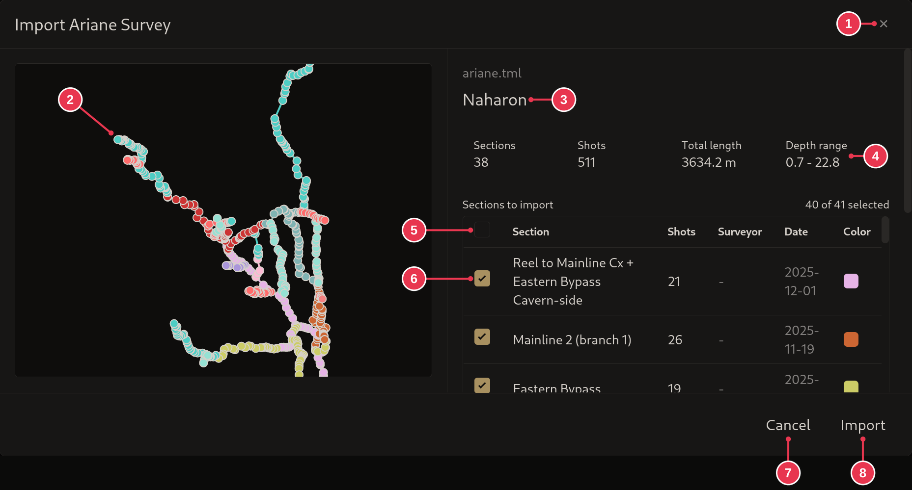

# Import Ariane Survey dialog

Shows what is in an Ariane `.tml` / `.tmlu` file and imports it. Comes after
the [Create Project for Import dialog](create-project-for-import.md).

1. **Close**: nothing imported.
2. Outline of the survey.
3. File and cave name.
4. What will be imported: sections, shots, total length, depth range. Updates
   as you pick sections.
5. Select all or none.
6. Tick the sections to import.
7. **Cancel**
8. **Import**

## Details

- Further down: **Where does this survey go?** (the position in the file, the
  origin, or coordinates you enter), and options for excluded shots, comments
  and virtual shots.
- A section marked **(moved to origin)** connects to nothing else being
  imported, so it is placed at the origin. **(branch)** marks a section split
  off at a branch.
- Imperial files are converted to metric.
