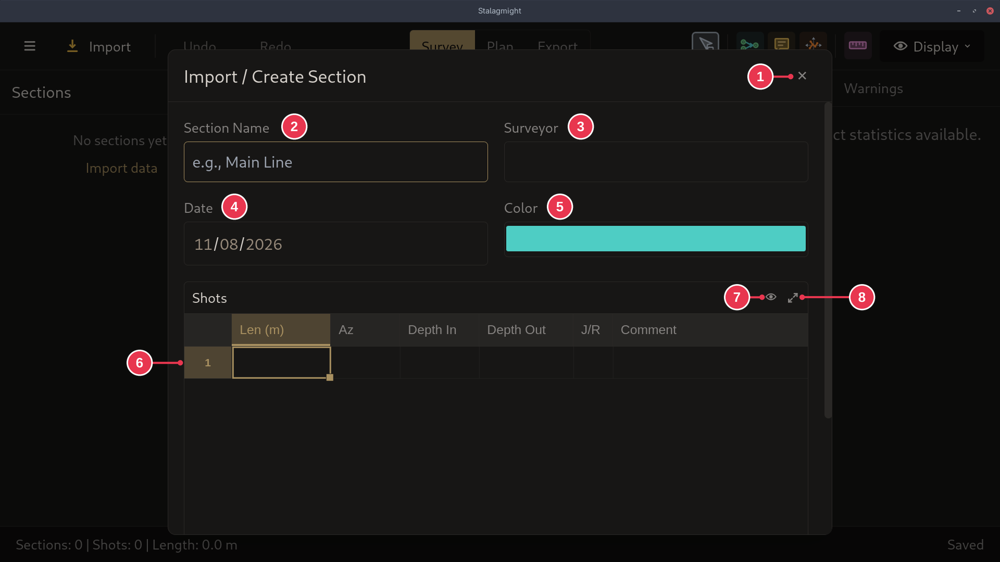

# Import / Create Section dialog

Creates a section from shots you type or paste in. Opened by **Add section** in
the [survey view](survey-view.md).

1. **Close**: nothing created.
2. **Section Name**
3. **Surveyor**
4. **Date**: when the line was surveyed.
5. **Color**: the section's color on the map.
6. **Shots**: one row per shot. See
   [Sections, shots and stations](../concepts/sections-shots-stations.md).
7. Show or hide table columns.
8. Enlarge the table.

## Details

- **Cancel** and **Create Section** are below the table. Scroll down if the
  window is small.
- **Create Section** needs at least one complete shot. After clicking it, you
  place the section on the map. Placing it on an existing station merges the
  two.
- Name, surveyor and date are optional. Color starts as the next unused section
  color.
- You can paste rows copied from a spreadsheet into the table.
