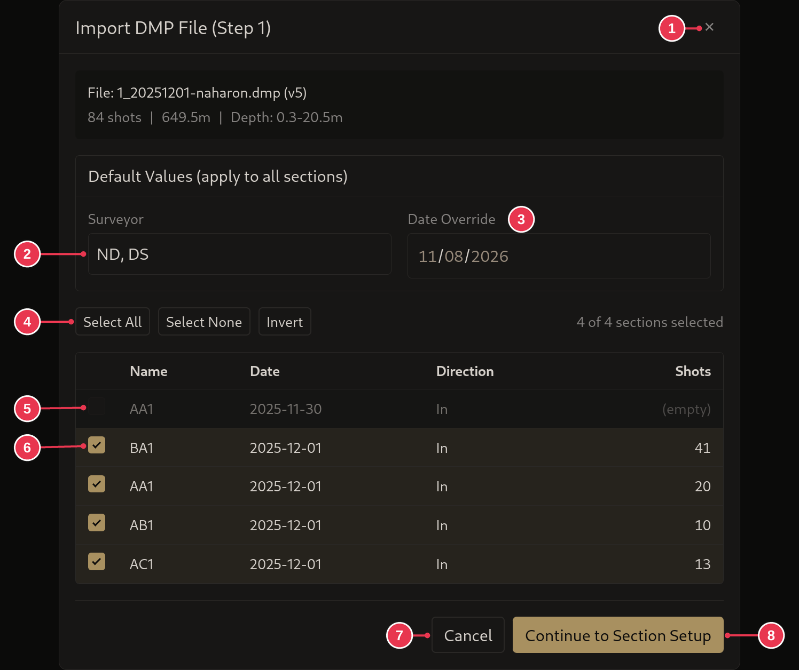
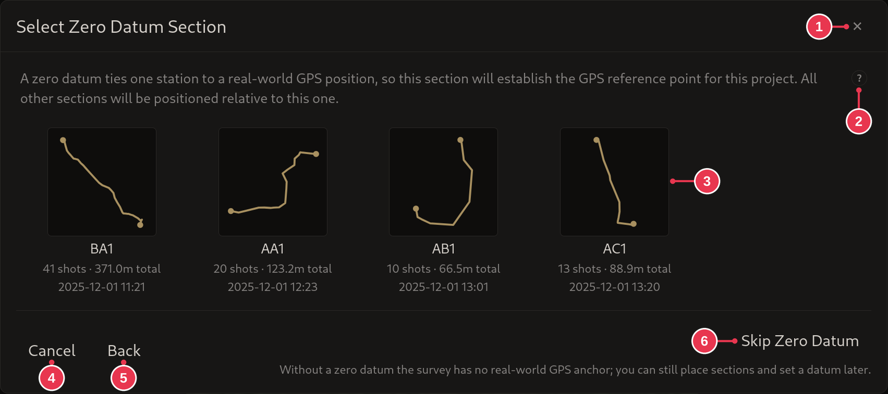
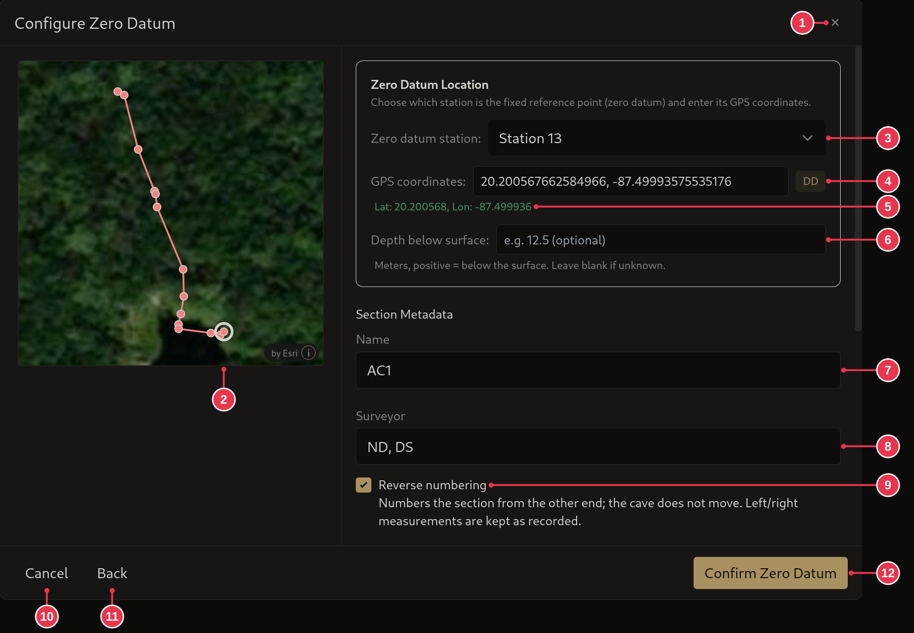
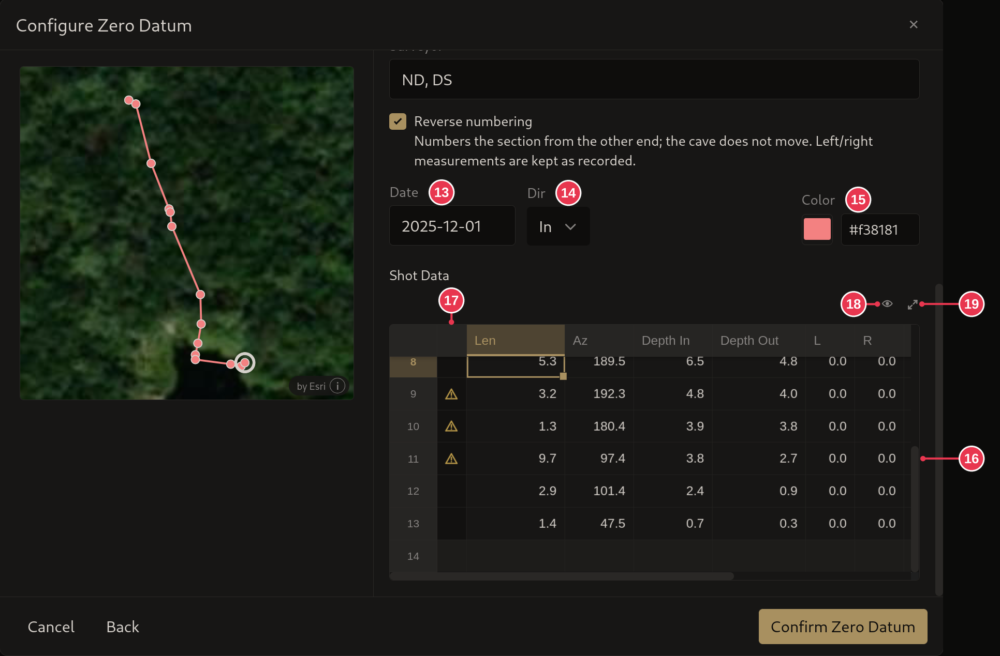

# DMP import

Imports an mNemo `.dmp` file into the open project, in steps. Opened by
**Import** in the [survey view](survey-view.md).

## Step 1: pick sections

1. **Close**: nothing imported.
2. **Surveyor**: for every imported section.
3. **Date Override**: one date for every section, instead of the dates in the
   file.
4. **Select All**, **Select None**, **Invert**
5. An empty section. It has no shots and can't be picked.
6. Tick the sections to import.
7. **Cancel**: same as 1.
8. **Continue to Section Setup**

### Details

- Sections already imported into this project are marked **(already imported)**
  and left unticked. A whole file imported before gets a warning at the top.
- The box at the top shows the file, its number of shots, total length and
  depth range.
- **Direction**: whether the line was surveyed going in or out.

## Step 2: zero datum (optional)

Only shown when the project has no
[zero datum](../concepts/sections-shots-stations.md) yet.

1. **Close**: nothing imported.
2. Help on zero datums.
3. Click the section that should carry the zero datum. Next you pick its
   station and GPS position.
4. **Cancel**: same as 1.
5. **Back**: to step 1.
6. **Skip Zero Datum**: import without one. It can be
   [set later](../workflows/setting-a-zero-datum.md).

## Step 3: zero datum station and position

After picking a section in step 2.

1. **Close**: nothing imported.
2. Preview. The ring marks the zero datum station. Click a station to pick it.
3. **Zero datum station**
4. **GPS coordinates**, in any [GPS format](edit-station-dialog.md#gps-formats).
   The badge shows the format it was read as.
5. The position as read from 4.
6. **Depth below surface**: optional, in meters, positive below the surface.
7. **Name**
8. **Surveyor**
9. **Reverse numbering**: number the stations and shots from the other end
   (ticked here). The cave does not move.
10. **Cancel**: same as 1.
11. **Back**: to step 2.
12. **Confirm Zero Datum**: disabled until 4 can be read.

Scrolled down, the section's details and shots:

13. **Date**
14. **Dir**: surveyed going in or out.
15. **Color**
16. **Shot Data**: every shot of the section. Values can be changed here, or
    any time later.
17. A ⚠ in this column marks a shot with a warning. Hover it to read it.
18. Choose visible columns.
19. Enlarge the table.
