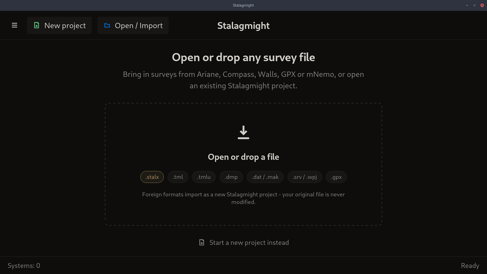

# Start screen

Shown at launch until you open a project. After that it lists recent projects.

- **New project**: start an empty project. See
  [Creating a new survey](../workflows/creating-a-new-survey.md).
- **Open / Import**: open a `.stalx` project or import another format. Clicking
  the dashed area or dropping a file on the window does the same.

## Details

- Formats: `.stalx` (Stalagmight), `.tml` / `.tmlu` (Ariane), `.dmp` (mNemo),
  `.dat` / `.mak` (Compass), `.srv` / `.wpj` (Walls), `.gpx` (GPX).
- An import creates a new project. The original file is not changed.
- **Start a new project instead** is the same as **New project**.
- `Systems: 0` is the number of recent projects.
- The very first launch may show an orientation and a usage-statistics question
  on top of this screen.
