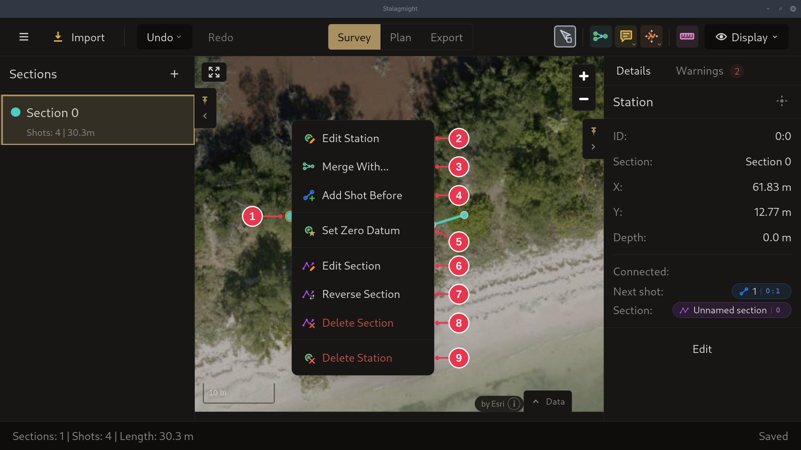

# Station context menu

Right-click a station on the map.

1. The station you right-clicked.
2. **Edit Station**
3. **Merge With...**: then click the station to merge with. See
   [merging](../concepts/sections-shots-stations.md).
4. **Add Shot Before**: first station only. The last station has **Add Shot
   After** instead.
5. **Set Zero Datum**: tie this station to a GPS position. See
   [Setting a zero datum](../workflows/setting-a-zero-datum.md).
6. **Edit Section**
7. **Reverse Section**
8. **Delete Section**
9. **Delete Station**

## Details

- Merged stations also get **Unmerge Stations**. Stations on a loop closure get
  **Remove Closure**.
- Both deletes ask for confirmation first.
