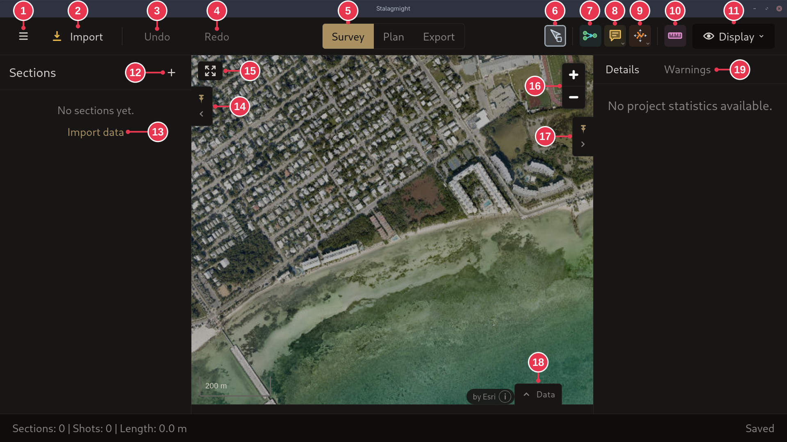

# Survey view

The main window of an open project: the map, with **Sections** on the left,
**Details** on the right and **Data** at the bottom.

**Top bar**

1. **Menu**
2. **Import**: add data from a file, for example a `.dmp` from an mNemo.
3. **Undo**
4. **Redo**
5. **Survey** / **Plan** / **Export**: edit the survey, plan a dive, or export
   a map.

**Tools**

6. **Select** (`S`)
7. **Merge** (`M`): merge two stations to connect sections. See
   [Sections, shots and stations](../concepts/sections-shots-stations.md).
8. **Comment**: put a comment on the map.
9. **Move**: move a segment, shot or station.
10. **Measure** (`R`): measure on the map.
11. **Display**: what the map shows.

**Panels and map**

12. **Add section**: enter a new section by hand in the
    [Import / Create Section dialog](create-section-dialog.md).
13. **Import data**: same as 2.
14. Pin or hide the **Sections** panel.
15. **Fit to view**: zoom to the whole survey.
16. Zoom in / out.
17. Pin or hide the **Details** panel.
18. **Data**: tables of sections and raw shot data.
19. **Details**: project statistics or the selected item. **Warnings**: problems
    found in the data.

## Details

- The small arrow on 8 and 9 picks a variant: **Move comment**, or **Move
  segment** / **Move shot** / **Move station**.
- An unpinned panel slides out when you hover its edge.
- Status bar: number of sections and shots, total length, save state.
- A project without data opens the map on the default location from Settings.
- Satellite imagery by Esri.
