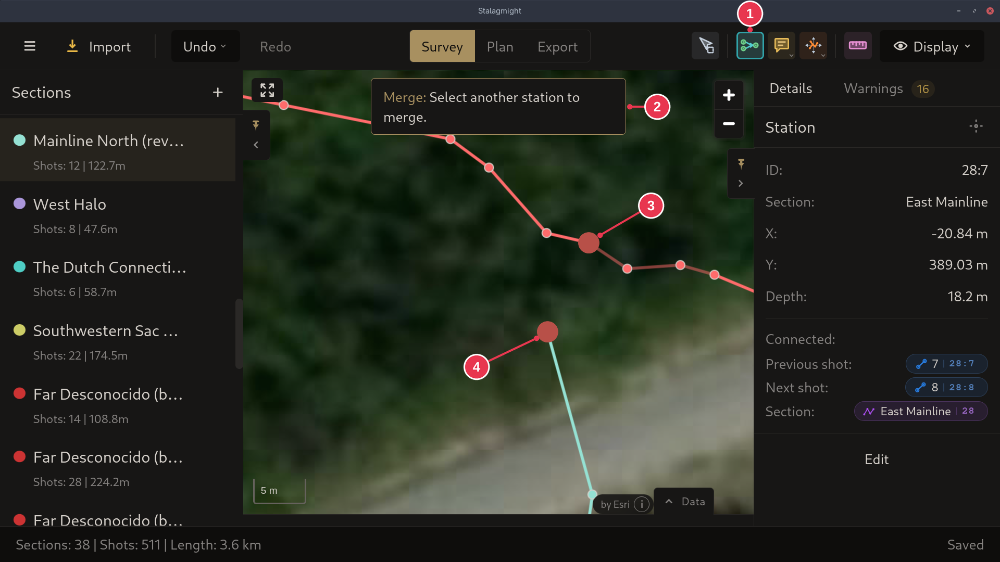

# Closing a loop

Use the **Merge** tool on two stations that cannot be merged: their sections
are already connected another way, or both are fixed by a
[zero datum](../concepts/sections-shots-stations.md). Stalagmight then creates a
[loop closure](../concepts/sections-shots-stations.md) instead.

1. In the [survey view](../screens/survey-view.md), pick **Merge** (`M`).
2. Click the first station, then the second.

The closure shows as a dashed line. The survey itself does not move. To see it
adjusted to its closures, switch to **Plan**, or pick **Closures Computed View**
under **Display**.

## Step details

### 1-2. Pick both stations

- **Merge** (1) is active, as for [merging stations](merging-stations.md).
- The first station (3) is picked. Click the second (4).
