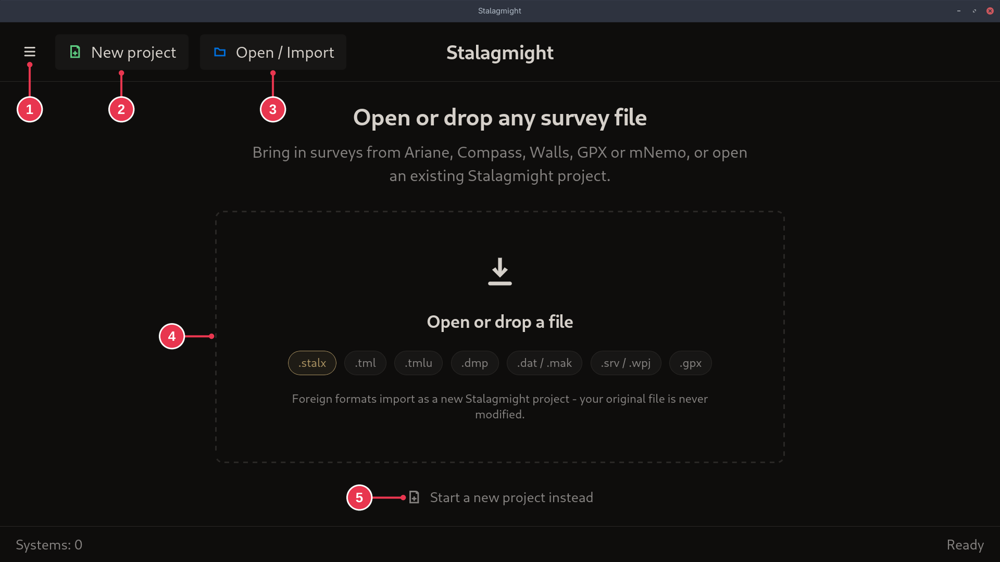
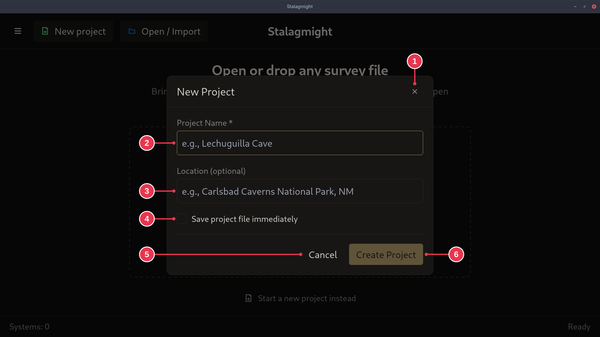

# Creating a new survey

1. On the [start screen](../screens/start-screen.md), click **New project**.
2. In the [New Project dialog](../screens/new-project-dialog.md), enter a name
   and click **Create Project**.

Tick **Save project file immediately** to create the file right away. Otherwise
it is saved once you add data.

Already have the survey in another program? Use **Open / Import** instead.

## Step details

### 1. New project

Click **New project** (2) or **Start a new project instead** (5). A dialog asks
for the project details.

### 2. Project details

- **Project Name** (2) is required. **Location** (3) is optional.
- **Save project file immediately** (4): ticked, the `.stalx` file is created
  as soon as the project opens. Unticked, it is saved only once you add data.
- **Create Project** (6) opens the new project.
