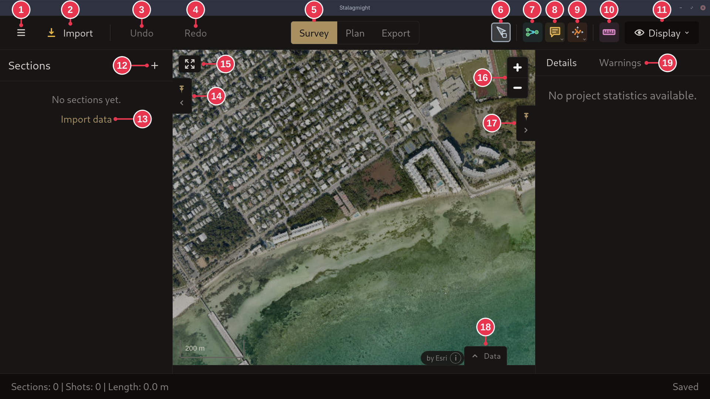
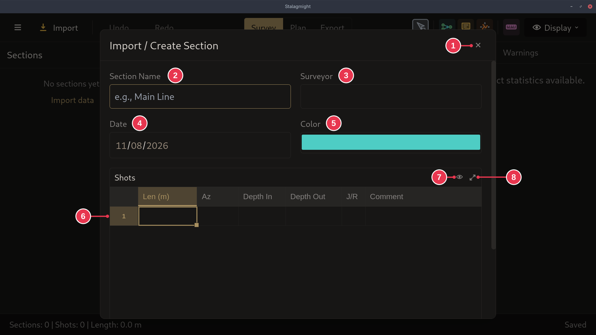

# Creating a new survey

1. On the [start screen](../screens/start-screen.md), click **New project**.
2. In the [New Project dialog](../screens/new-project-dialog.md), enter a name
   and click **Create Project**.
3. In the [survey view](../screens/survey-view.md), add data: **Import** a file
   (for example a `.dmp` from an mNemo), or click **+** next to **Sections** to
   enter it by hand.
4. Entering by hand: in the
   [Import / Create Section dialog](../screens/create-section-dialog.md), name
   the section and set the surveyor, date and color.

Tick **Save project file immediately** to create the file right away. Otherwise
it is saved once you add data.

Already have the survey in another program? Use **Open / Import** on the start
screen instead.

## Step details

### 1. New project

Click **New project** (2) or **Start a new project instead** (5). A dialog asks
for the project details.

### 2. Project details

- **Project Name** (2) is required. **Location** (3) is optional.
- **Save project file immediately** (4): ticked, the `.stalx` file is created
  as soon as the project opens. Unticked, it is saved only once you add data.
- **Create Project** (6) opens the new project.

### 3. Add data

- **Import** (2) or **Import data** (13): read data from a file, for example a
  `.dmp` from an mNemo.
- **Add section** (12): start an empty section and enter shots by hand. See
  [Sections, shots and stations](../concepts/sections-shots-stations.md).

### 4. Section details

- **Section Name** (2), **Surveyor** (3) and **Date** (4, when the line was
  surveyed) are optional.
- **Color** (5) is how the section shows on the map.
