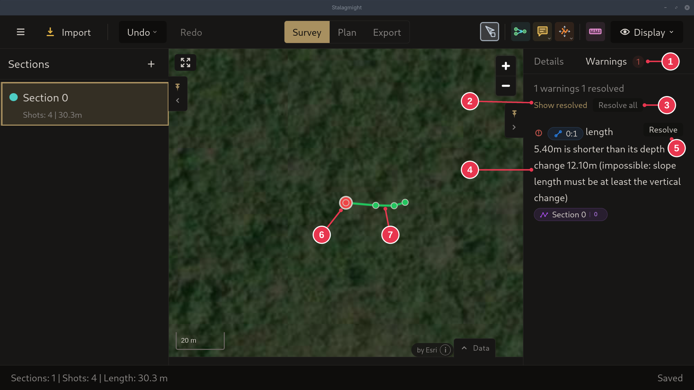

# Fixing warnings

1. Open the **Warnings** tab in the [survey view](../screens/survey-view.md).
   Red on the map is an error, yellow a warning.
2. Click **Resolve** on a warning and pick a fix.

## Step details

### 1. Warnings tab

- Here the first shot is shorter than its depth change (4), which is
  impossible. Its station is red on the map (6).
- **Resolve** (5) fixes one warning, **Resolve all** (3) goes through all of
  them. See the [Warnings panel](../screens/warnings-panel.md).
