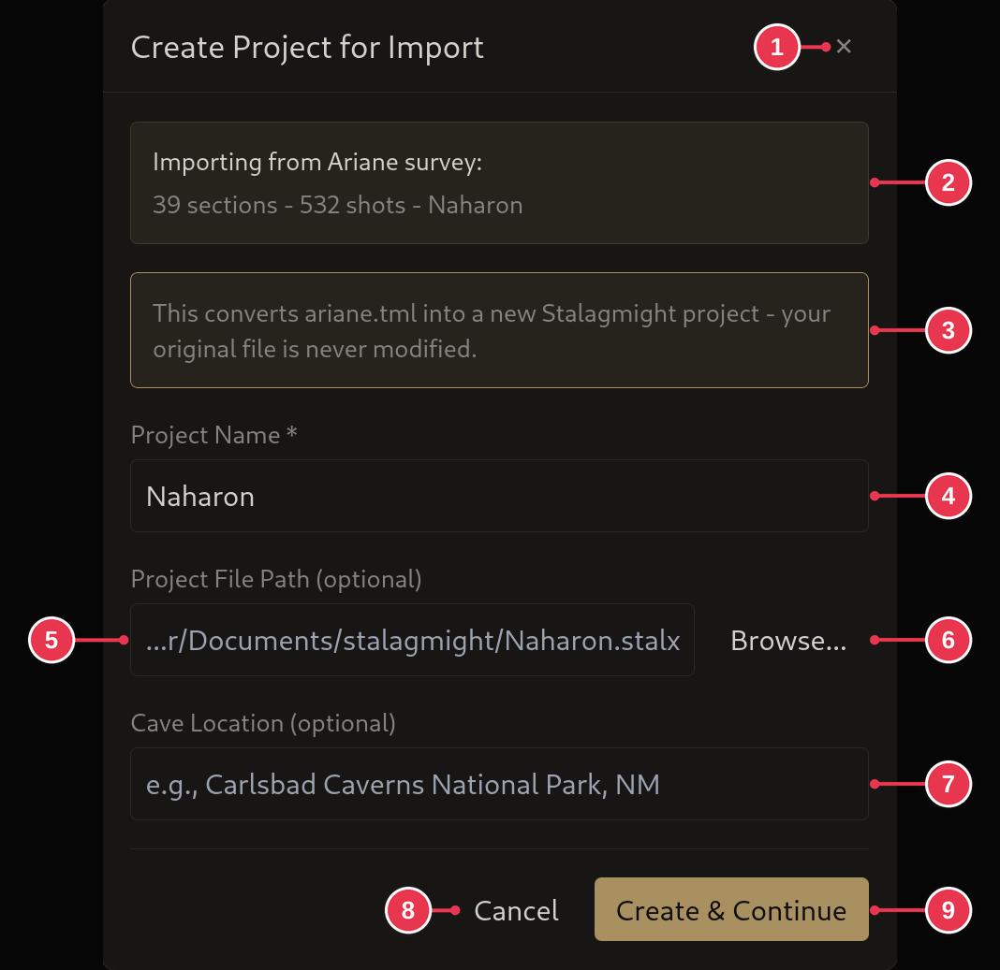

# Importing an Ariane survey

1. On the [start screen](../screens/start-screen.md), click **Open / Import**
   and pick the `.tml` or `.tmlu` file, or drop it onto the window.
2. Name the project and click **Create & Continue**. Where it is saved and the
   cave location are optional.

## Step details

### 2. Create the project

- **Project Name** (4) starts as the cave name in the file, or the file name.
- **Project File Path** (5): leave empty for the default, or **Browse...** (6).
- **Create & Continue** (9).
- See [Create Project for Import](../screens/create-project-for-import.md).
