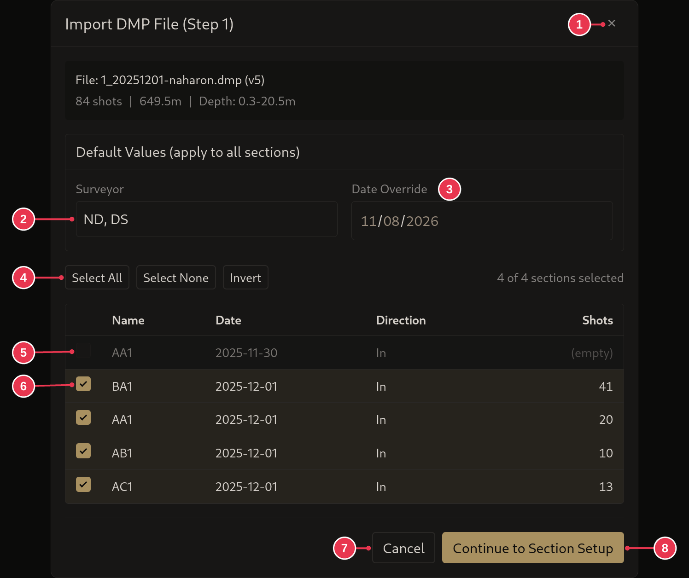
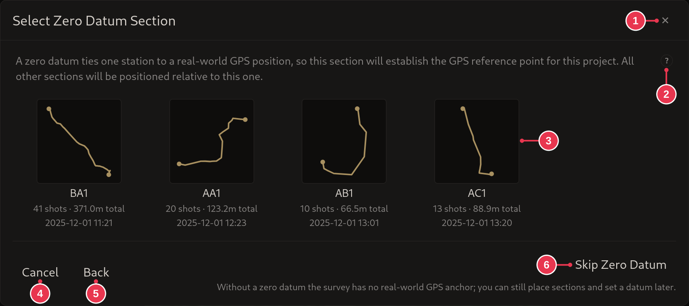
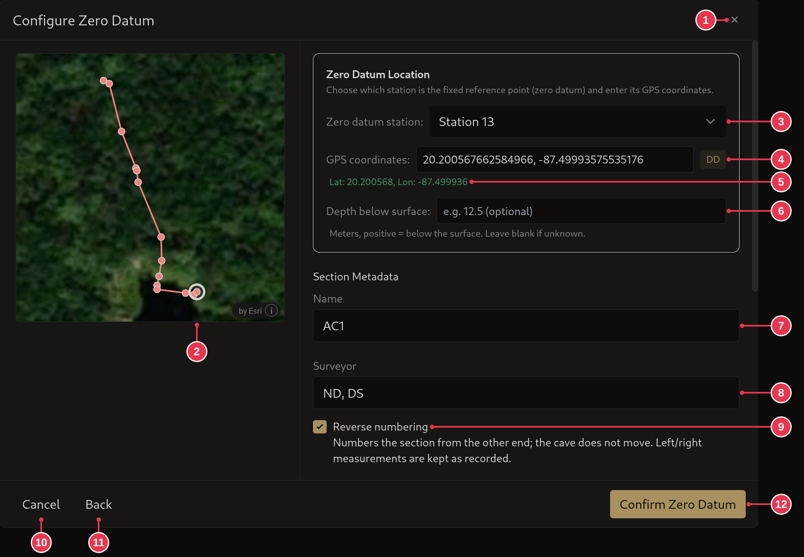

# Importing from an mNemo

1. In the [survey view](../screens/survey-view.md), click **Import** and pick
   the `.dmp` file.
2. Tick the sections to import and click **Continue to Section Setup**. Empty
   and already imported sections are left out for you.
3. Optional: click the section that should carry the
   [zero datum](../concepts/sections-shots-stations.md), or **Skip Zero
   Datum** and [set it later](setting-a-zero-datum.md).
4. If you picked one: choose its station, enter the GPS position and click
   **Confirm Zero Datum**.

## Step details

### 2. Pick sections

- Ticked sections (6) are imported. Empty ones (5) can't be picked.
- **Surveyor** (2) and **Date Override** (3) apply to every section.
- See [DMP import](../screens/dmp-import.md).

### 3. Zero datum

- Only asked when the project has no zero datum yet.
- Click the section's card, AC1 here (3).
- **Skip Zero Datum** (6) imports without one.

### 4. Zero datum station and position

- **Zero datum station** (3): station 13 here. Clicking a station on the
  preview (2) picks it too.
- **GPS coordinates** (4), in any
  [GPS format](../screens/edit-station-dialog.md#gps-formats). Check what it
  read (5).
- **Confirm Zero Datum** (12).
