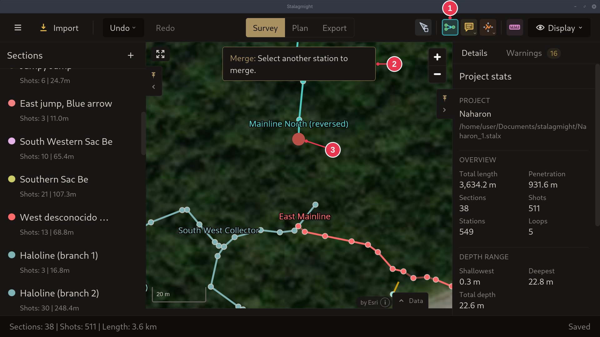

# Merging stations

Joins two sections at a shared station. Useful when a section could not be
placed from reference shots and was placed by hand.

1. In the [survey view](../screens/survey-view.md), pick **Merge** (`M`) in the
   toolbar.
2. Click the station to merge.
3. Click the station to merge it to.

Right-clicking a station and picking **Merge With...** does steps 1 and 2 in one
go. See the [station context menu](../screens/station-context-menu.md).

## Step details

### 1-2. Merge tool and first station

- **Merge** (1) is active.
- The first station (3) is picked. The banner (2) asks for the second.

### Details

- After the second click, Stalagmight checks that the merge is possible. If it
  is not, a notification says why.
- See [merging](../concepts/sections-shots-stations.md).
