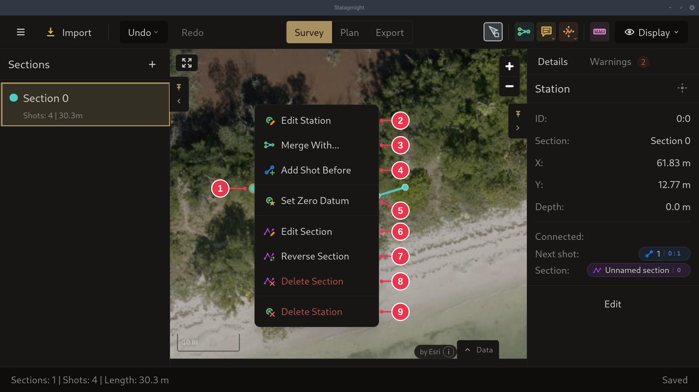

# Setting a zero datum

A [zero datum](../concepts/sections-shots-stations.md) ties one station to a
real-world GPS position.

1. Right-click the station on the map and pick **Set Zero Datum**.

## Step details

### 1. Set Zero Datum

Right-click the station (1) and pick **Set Zero Datum** (5). It opens **Edit
Station** with the zero datum switched on, ready for the GPS position. See the
[station context menu](../screens/station-context-menu.md).
